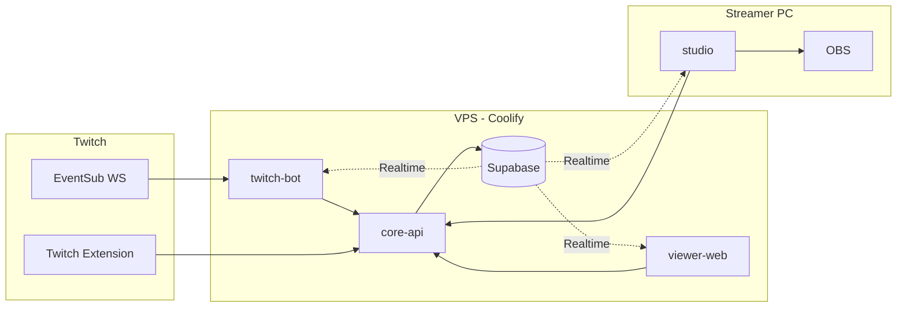
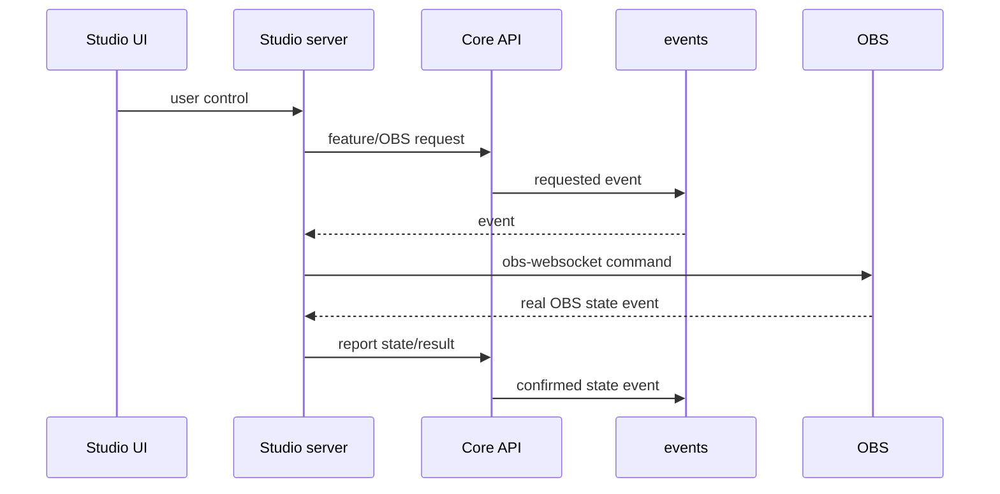
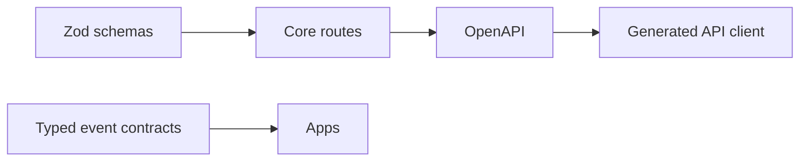

# Streamer Stack — Infrastructure Spec Update

2026-09-24 · updated after architecture clarification

## 1. Product vision

Raptoru 2.0 is a self-owned streaming platform for one streamer.

The objective is **not** to rebuild SAMMI as a generic automation editor or to reproduce its internal button/workflow model.

The project separates responsibilities that SAMMI previously concentrated in one application:

- **`core-api`** owns domain logic, shared state, feature orchestration and persistence.
- **`studio`** is the local streamer-facing control/configuration interface and the only bridge to OBS.
- **`twitch-bot`** is a thin Twitch adapter: it receives Twitch events/chat and executes Twitch-side commands requested by Core.
- **`twitch-extension`** and **`viewer-web`** are viewer-facing entry points.
- **OBS** remains the audiovisual runtime and is controlled locally by Studio.

The design goal is that a feature such as Tombola, Bonk, TTS, Daily, Jeu des mots or Votekick exists **once** as domain logic in Core. Chat, Studio, the Twitch extension and the public website may all trigger or configure that same feature without duplicating its business rules.

This is the central architectural rule:

> **Core API is the only place where shared domain logic and shared persistent state live.**

Studio is not a second backend, and Twitch Bot is not a second feature engine.

---

## 2. Why this architecture exists

SAMMI is highly configurable and therefore useful as a general-purpose tool, but that flexibility comes with a proprietary workflow model, many implementation details exposed as buttons, and difficult debugging/testing for AI-assisted development.

Raptoru 2.0 instead favors normal TypeScript application code:

- business logic is written in ordinary, testable code;
- configuration exposed to the streamer is data, not a programming language;
- AI tools can modify feature code, run tests and reason about standard schemas;
- the same feature can be triggered from multiple surfaces without duplicating logic;
- persistent state is centralized;
- crashes and reconnects are easier to recover from;
- internal implementation details do not need to appear in the streamer UI.

Example:

Today a SAMMI feature may contain many internal buttons such as `ShuffleWord`, `SESSION_SYNC`, `STREAK_ANNOUNCER`, etc.

In Raptoru 2.0 those are implementation details of a **Jeu des mots feature module** in Core. Studio exposes only useful controls and settings such as Start, Stop, Force new word, difficulty, rewards, golden-word chance and logs.

---

## 3. Configuration vs business logic

A fundamental distinction:

### Streamer-editable configuration

The streamer should be able to change simple values without modifying code or waiting for an AI/dev round trip.

Examples:

- price;
- reward amount;
- cooldown;
- duration;
- frequency;
- probability;
- multiplier;
- max text length;
- permissions;
- enabled/disabled;
- animation duration;
- font;
- position;
- size;
- color;
- overlay asset;
- sound file;
- volume;
- min/max raffle interval;
- difficulty;
- moderation settings.

These values are persisted as feature configuration and edited from Studio.

### Business logic

Behavioral changes belong in Core code.

Examples:

- “Subscribers receive two raffle tickets during raids.”
- “Three Bonks in two seconds merge into a burst.”
- “Daily streak breaks only when the viewer misses an actual stream session.”
- “Votekick initiator is punished when the vote fails under specific rules.”

The intended workflow is:

1. describe the desired feature/change to an AI or developer;
2. modify normal TypeScript code in the appropriate module;
3. run automated tests;
4. deploy/restart only the affected service(s);
5. expose any useful settings in Studio.

The streamer does **not** need to edit the implementation logic in Studio.

---

## 4. Deployment topology

Three apps run on the VPS under the existing Coolify instance, the extension frontend is hosted by Twitch, and Studio runs on the streamer PC.

The streamer PC only makes outbound connections, so nothing on it is exposed to the internet.

| App | Runs on | Publicly exposed | Responsibility |
| --- | --- | --- | --- |
| `core-api` | VPS (Coolify) | Yes, HTTPS (also EBS) | Central source of truth, feature logic, shared state, persistence, orchestration |
| `twitch-bot` | VPS (Coolify) | No | Twitch EventSub/chat adapter and Twitch-side executor |
| `viewer-web` | VPS (Coolify) | Yes, HTTPS | Public viewer UI |
| `twitch-extension` | Twitch CDN, EBS=`core-api` | Via Twitch | Viewer interaction UI |
| `studio` | Streamer PC | No (`127.0.0.1`) | Streamer control/config UI, overlays, local OBS bridge |
| Supabase | VPS (Coolify) | Yes, HTTPS | Postgres, Realtime, Auth, Storage |



Core is a hard dependency for shared stream features. If Core is unavailable, Studio remains usable for local UI/status and local OBS connectivity, but shared feature commands fail fast rather than being queued and replayed later.

Internet-offline operation is not a primary product requirement because the streaming platform itself depends on online services.

---

## 5. Monorepo layout

The repo is a Turborepo on npm workspaces.

```text
/
├─ apps/
│  ├─ core-api/
│  ├─ twitch-bot/
│  ├─ twitch-extension/
│  ├─ studio/
│  │  ├─ server/
│  │  ├─ web/
│  │  └─ desktop/
│  └─ viewer-web/
├─ packages/
│  ├─ schemas/
│  ├─ events/
│  ├─ api-client/
│  ├─ config/
│  └─ ui/
├─ supabase/
├─ docker/
├─ .github/workflows/
├─ turbo.json
└─ package.json
```

Shared packages contain schemas/contracts and reusable UI primitives, not shared business logic that bypasses Core.

---

## 6. Responsibility of each app

### 6.1 `core-api`

Core is the **brain of the platform**.

It owns:

- feature/domain logic;
- feature configuration;
- persistent viewer state;
- balances/jetons;
- stream-session state;
- cooldowns;
- eligibility rules;
- queues;
- rewards;
- moderation state;
- raffle state;
- game state;
- idempotency;
- event journal;
- orchestration of actions across Studio, Twitch Bot and viewer surfaces.

Representative feature modules include:

- Daily / streak;
- wallet / jetons;
- Cash-in;
- subscription reward wheel;
- alerts configuration/state;
- TTS;
- Soundboard;
- Bonk;
- Tombola;
- Jeu des mots;
- RandomBan;
- Votekick;
- Caution;
- Spotify/song requests;
- future event-specific modules.

A feature should be implemented once in Core even when it can be triggered from multiple places.

Example:

```text
Extension Bonk button ─┐
Chat Bonk command ─────┼──> Core Bonk feature ──> debit/check/rules ──> local visual/audio command
Studio test button ────┘
```

Core decides **whether** something may happen and **what** the result is.

It does not directly manipulate OBS.

### 6.2 `studio`

Studio replaces only the parts of SAMMI that fundamentally belong on the streamer PC:

1. streamer-facing IHM/control panel;
2. feature configuration UI;
3. previews/testing controls;
4. local overlays;
5. OBS bridge.

Studio is **not** a general-purpose programming environment and is **not** a generic SAMMI clone.

Typical Studio pages:

- Dashboard;
- Alerts;
- TTS;
- Soundboard;
- Bonk;
- Tombola;
- Jeu des mots;
- Moderation / chat games;
- Spotify;
- OBS;
- Overlays;
- Logs/activity;
- Settings.

Studio should expose useful feature settings, state and actions rather than internal implementation steps.

Example Tombola page:

- Open / Close / Draw now;
- automatic draw enabled;
- min/max interval;
- reward;
- participants;
- recent winners;
- logs.

The internal code required to perform the draw does not appear as separate “buttons”.

### 6.3 `twitch-bot`

`twitch-bot` is the only process connected to Twitch EventSub.

Its role is intentionally thin:

- receive Twitch notifications;
- normalize them;
- forward them to Core;
- receive Core commands for Twitch-side actions;
- send chat messages;
- perform moderation/Helix operations when requested;
- manage Twitch connection/reconnect/token concerns.

It should **not** own durable game/business logic such as Tombola, Jeu des mots, Daily, Votekick rules or balances.

This makes chat just one possible interface.

If `!join` is later removed in favor of the Twitch extension, the Tombola feature should not need to be rewritten.

### 6.4 `twitch-extension`

The extension is a viewer-facing interface.

It may:

- display interactive modules;
- initiate feature requests;
- show previews;
- expose viewer personalization;
- authenticate/identify the viewer through Twitch;
- receive public feature state.

It does not own authoritative balances, rewards, cooldowns, raffle winners, moderation state or game logic.

Example:

A viewer can trigger Bonk from the extension. The extension submits intent; Core validates price, balance, permissions and concurrency, then emits the resulting commands/events.

### 6.5 `viewer-web`

Same principle as the extension: viewer UI and entry point, not domain authority.

### 6.6 OBS

OBS remains OBS.

Only Studio talks to `obs-websocket`.

Core may request an OBS-side effect, but Studio executes it locally and reports the resulting OBS state back to Core.

---

## 7. Feature execution model

A typical feature crosses multiple components but has a single owner.

Example: TTS from Twitch extension.

```text
Viewer
  ↓
Twitch Extension
  ↓ intent
Core API
  - validates viewer
  - validates text
  - calculates price
  - checks balance
  - checks moderation/cooldown
  - queues item
  - debits transaction
  ↓ event/command
Studio
  - renders character
  - plays generated TTS locally/through overlay
  ↓ result
Core API
  - records success/failure
  - refunds if required
  - advances queue
```

The same TTS feature may later be triggered by chat or Studio without duplicating the business rules.

---

## 8. Stream sessions

“Stream started” is domain state, not merely a local button state.

Core owns the current stream session.

This state gates features that must only operate during a real stream.

Example: Daily.

A viewer’s Daily streak advances once per stream session. Calling `!daily` while there is no active stream must not create a fake day/session or break streak semantics.

Studio may expose Start Stream / End Stream controls if automatic Twitch online/offline detection is insufficient or if a manual override is useful, but the authoritative state belongs to Core.

---

## 9. Feature configuration model

Each feature can expose a typed configuration schema.

Examples:

### TTS

- enabled;
- price formula;
- max length;
- short/long cooldown;
- queue limits;
- blacklist;
- moderation pause;
- voice/character policy;
- viewer-specific character override;
- refund-on-failure.

### Soundboard

- sound catalogue;
- price;
- long-sound price;
- enabled;
- permissions;
- moderation blacklist;
- anti-spam policy;
- asset;
- display metadata.

### Alerts

- enabled;
- visual asset;
- sound asset;
- text template;
- font;
- size;
- color;
- position;
- duration;
- animation in/out;
- preview/test.

### Tombola

- enabled;
- random interval min/max;
- reward;
- number of winners;
- join surfaces allowed;
- eligibility rules.

### Jeu des mots

- word bank;
- spawn frequency or adaptive mode;
- reward formula;
- streak behavior;
- golden-word chance;
- golden multiplier;
- difficulty.

Schemas should be typed and validated with Zod.

Studio can generate or hand-build good UI controls around those schemas.

---

## 10. Temporary/event features

Special-event features are legitimate first-class modules.

Examples:

- Halloween;
- 24h stream;
- anniversary;
- one-off interactive challenge.

They do not require a generic SAMMI-like workflow language.

An AI/developer can add an event module in normal code, expose the relevant settings/controls in Studio, and disable/archive the module after the event.

A service restart or application restart is acceptable for loading a new code version. Restarting the entire PC, OBS or live stream should not be required unless technically unavoidable.

---

## 11. Automation/orchestration scope

Raptoru 2.0 may keep internal orchestration primitives where they are useful, for example:

- sequential command execution;
- idempotency;
- confirmation;
- retries;
- restart recovery;
- persistent waits;
- simple guards/conditions;
- event correlation.

These are **infrastructure primitives**, not a product goal of rebuilding SAMMI.

The project should not automatically grow into a general-purpose visual/programmatic workflow language with:

- arbitrary loops;
- mutable workflow variables;
- deeply nested configurable branching;
- a proprietary DSL;
- hundreds of user-authored internal buttons;
- generic logic editing inside Studio.

Before adding such capabilities, the team must demonstrate a concrete product requirement that cannot be expressed more simply as normal Core feature code plus typed configuration.

The existing automation engine should therefore be reviewed as infrastructure and simplified if necessary, rather than expanded by default.

---

## 12. Event bus

The event bus remains append-only Postgres `events` + Supabase Realtime push.

`events` is the source of truth for replay; Realtime is only the fast notification channel.

Event envelope:

| Field | Type | Notes |
| --- | --- | --- |
| `seq` | bigint identity | Global replay cursor |
| `id` | uuid | Event id / dedupe |
| `type` | text | Versioned event type |
| `version` | int | Payload schema version |
| `payload` | jsonb | Zod-validated |
| `source` | text | Emitting app |
| `correlation_id` | uuid | Links commands/results |
| `visibility` | text | `internal` or `public` |
| `occurred_at` | timestamptz | Database-stamped time |

Consumer protocol remains:

1. read last processed `seq`;
2. subscribe to Realtime INSERT;
3. catch up `seq > cursor`;
4. buffer live events during catch-up;
5. dedupe by seq/id;
6. repeat on reconnect/gap.

Delivery is at-least-once and handlers must be idempotent.

Retention remains 24 hours, with snapshots/current state used after replay retention is exceeded.

---

## 13. Commands and idempotency

Commands go to Core over HTTP with `Idempotency-Key`.

Retries must return the original result rather than duplicate the side effect.

Core persists/coordinates shared decisions.

For local effects:

1. Core journals/request an effect;
2. Studio receives it;
3. Studio executes it in OBS/overlay;
4. Studio reports the result/state;
5. Core records the confirmation.

Old local effects that arrive after a long disconnect must be dropped according to TTL rules instead of unexpectedly executing late.

---

## 14. OBS integration

Studio is the only process connected to OBS.



This path gives Core a coherent event history and keeps OBS credentials/control local.

A future architecture review may allow direct Studio→OBS execution for purely local/manual operations if the round trip through Core provides no meaningful consistency benefit. This must be a deliberate exception, not a second business-logic path.

---

## 15. Assets and overlays

Persistent overlay/sound/image assets live in Storage and are managed through Core.

Studio provides friendly upload/configuration/preview tools.

Viewer-facing UI may personalize layout locally where appropriate, but authoritative feature configuration stays server-side.

Examples of viewer-local QOL:

- extension button arrangement;
- preview volume;
- display preferences;
- tutorial state.

These do not change game rules or shared outcomes.

---

## 16. Security and communication

Server apps authenticate to Core with per-service secrets.

| Caller | Auth |
| --- | --- |
| `twitch-bot` → `core-api` | `BOT_SECRET` |
| `studio` → `core-api` | `STUDIO_SECRET` |
| extension → EBS | Twitch extension JWT |
| authenticated web viewer → Core | Supabase/Twitch user JWT |

Only Core writes shared domain state to Postgres.

Studio secrets stay server-side in `studio/server`, never in browser JS.

---

## 17. Authentication

Human users authenticate with Twitch where required.

- viewer-web: Supabase Auth Twitch provider;
- extension: Twitch extension JWT;
- Studio: local-only control app, no streamer login required for local UI;
- broadcaster OAuth tokens: stored server-side and used by Core/Bot.

No local passwords are introduced.

---

## 18. Twitch integration

`twitch-bot` remains the sole EventSub WebSocket process.

Subscriptions include feature-required events such as:

- chat messages;
- follows;
- subs/resubs/gifts;
- cheers;
- raids;
- channel-point redemptions.

Notifications are normalized and passed to Core.

Chat commands such as `!join`, `!daily` or future commands are transport/UI affordances. Their underlying logic lives in Core.

If a feature migrates from chat to the extension, only its entry point should change.

---

## 19. Data & storage

Persistent state lives in Supabase/Postgres.

Examples:

- viewers;
- balances;
- daily streaks;
- stream sessions;
- feature configuration;
- raffle state/results;
- queues;
- moderation state;
- feature-specific domain tables;
- events;
- consumer offsets;
- idempotency keys;
- Twitch tokens.

Every schema change uses a versioned migration.

Only Core writes domain tables.

Storage buckets contain sounds/images/overlay assets.

---

## 20. API contracts and code generation

Zod schemas remain the source of truth.



- runtime validation and API docs use the same schemas;
- generated API client drift fails CI;
- event contracts remain versioned;
- feature config schemas are typed and validated.

This also makes the project AI-friendly: common TypeScript/Zod/OpenAPI structures are preferred over proprietary DSLs.

---

## 21. Environments

Two environments:

- `dev`: local Postgres/Supabase services, Twitch mocks, optional fake OBS;
- `prod`: Coolify VPS services + local Studio + Twitch production systems.

Development should support testing features without real Twitch traffic.

Real OBS may be used only for safe explicit integration tests.

---

## 22. CI/CD

GitHub Actions remains responsible for:

- lint;
- typecheck;
- tests;
- code generation;
- generated-file drift checks;
- build.

VPS apps are packaged/deployed independently.

Migrations run before compatible Core deployment.

Extension zip remains a separate artifact/manual Twitch upload flow.

Studio remains an Electron Windows application using the same local server/web UI architecture.

---

## 23. Studio product direction

Studio should progressively become a streamer cockpit, not a developer workflow canvas.

Desired high-level areas:

- Dashboard;
- stream session;
- Alerts;
- TTS;
- Soundboard;
- Bonk;
- Tombola;
- Jeu des mots;
- viewer economy;
- moderation/games;
- Spotify;
- OBS/scenes;
- Overlays/effects;
- activity/logs;
- feature settings.

Each feature page should prioritize:

- current state;
- useful controls;
- safe editable settings;
- test/preview;
- recent activity/errors.

Implementation internals should remain hidden unless debugging requires them.

---

## 24. Current architectural review required

Before adding more automation-engine capabilities, audit the current repository against this clarified architecture.

The audit must classify existing work into:

1. aligned and keep;
2. useful infrastructure but should become internal;
3. redundant/general-purpose SAMMI reconstruction to simplify/remove;
4. missing foundations required by this spec.

In particular, review the current automation engine.

Do **not** extend it with generic loops, mutable variables, branching language, deck concepts or workflow-editor UI until this audit is complete.

No wipe/rewrite should happen by default. Reuse is preferred when the existing implementation cleanly supports the clarified responsibilities.

---

## 25. Recommended next validation slice

After the architecture audit, implement or migrate one real feature end-to-end before starting another large infrastructure tunnel.

A good candidate is **Daily**, because it validates:

- stream-session state in Core;
- persistent viewer state;
- chat command input;
- business rules;
- configuration;
- Bot ↔ Core interaction;
- Studio visibility/control;
- logs;
- restart persistence.

After that vertical slice, reassess the architecture before migrating larger systems such as Tombola or Jeu des mots.

---

## 26. Decision summary

The intended system is **not**:

> “SAMMI, rebuilt from scratch with a nicer automation language.”

It is:

> “A central streaming backend containing normal, testable feature code, with multiple UIs/adapters around it.”

Or, in one line:

**Core thinks, Studio controls/displays and talks to OBS, Bot talks to Twitch, Extension/Web talk to viewers.**

That separation is the foundation for stability, maintainability, resilience, reuse and AI-assisted development.
