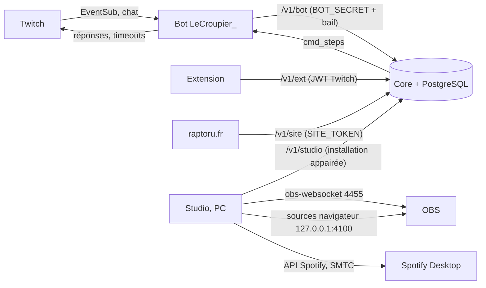

# Architecture actuelle

Mis à jour le **10/11/2026** (consolidation ; tableau d'origine du 24/10). Versions en service et environnements :
[PROJECT_STATUS.md](PROJECT_STATUS.md) § 3. Spécification d'origine (vision,
principes, bus d'événements, idempotence, sécurité) : [`Raptoru Studio — Infrastructure Spec.md`](../Raptoru%20Studio%20—%20Infrastructure%20Spec.md).
Reprise : [REPRISE.md](REPRISE.md). Procédures : [OPERATIONS.md](OPERATIONS.md).

**Objectif final** : piloter tout le stream depuis Raptoru Studio. Règle de partage :
**le Core décide, le bot parle à Twitch, Studio pilote OBS et affiche, l'extension et le site parlent aux viewers.**

## 1. Composants

| Composant            | Code                               | Où il tourne                                                                                              | Responsabilité                                                                                                                                                                                                                                                                                                                                      | Ne fait jamais                                     |
| -------------------- | ---------------------------------- | --------------------------------------------------------------------------------------------------------- | --------------------------------------------------------------------------------------------------------------------------------------------------------------------------------------------------------------------------------------------------------------------------------------------------------------------------------------------------- | -------------------------------------------------- |
| **Core API**         | `apps/core-api`                    | Coolify `raptoru-core` sur le VPS (`https://core.raptoru.fr`), base PostgreSQL 17 `raptoru-prod-postgres` | vérité de toutes les données : Wallet canonique (Jetons, crédits TTS / Soundboard), Daily, fidélité / présence, Tombola, Jeu des mots, Roulette / Slot / Duel, Commands V2 (`cmd_steps`), Points de chaîne, Random Ban, Roue du Sub, alertes, modération D4, Caution, Votekick (et ses réglages), frontière extension `/v1/ext`, bail du bot unique | parler à OBS                                       |
| **Bot LeCroupier_**  | `apps/twitch-bot`                  | Coolify `raptoru-bot`, conteneur sur le VPS, volume `/data` (`raptoru-bot-data`)                          | seul processus EventSub + chat : lit le chat et les événements (subs, bits, follows, points), les transmet au Core, exécute les actions Twitch décidées par le Core (réponses, timeouts Random Ban / Votekick, levées Caution) ; un seul bot actif (bail Core, auto-fencing)                                                                        | décider d'une règle métier ou d'un solde           |
| **Raptoru Studio**   | `apps/studio/{desktop,server,web}` | PC d'Antoni (Electron, serveur local `127.0.0.1:4100`), profil Production appairé au Core                 | console du streamer ; suit les files du Core et exécute localement : OBS (obs-websocket), lecteur d'effets, TTS, Soundboard, Bonk, Tombola, Jeu des mots (son), alertes V2, Votekick (overlay, mute du streamer, son de lancement), Centre de contrôle, supervision                                                                                 | décider d'un verdict, d'un débit ou d'une sanction |
| **OBS**              | —                                  | PC                                                                                                        | rendu du stream ; la scène **« Alerte complète »** est superposée à toutes les scènes par le **Downstream Keyer** et porte les sources Studio (`Alertes (V2)`, `Effets`, `TTS v2`, Tombola, `Bonk v2`, `Jeu des mots (SON)`, Votekick)                                                                                                              | —                                                  |
| **Extension Twitch** | `apps/twitch-extension`            | hébergée par Twitch (chaîne `raptoru_`, mono-chaîne)                                                      | interface viewer → Core `/v1/ext` (TTS, Soundboard, Bonk, Tombola, modération, Jetons) ; publiée à la main par Antoni dans la console Twitch                                                                                                                                                                                                        | garder un état faisant autorité                    |
| **viewer-web**       | `apps/viewer-web`                  | —                                                                                                         | squelette jamais utilisé : le site public est **raptoru.fr** (dépôt `raptorutwitch/Leaderboard-Jeu-des-mots`, Coolify), qui lit le Core par `/v1/site/*` (classements, profils, cosmétiques, défis, statistiques)                                                                                                                                   | —                                                  |
| **Schémas**          | `packages/schemas`                 | bibliothèque                                                                                              | contrats Zod partagés (requêtes / réponses Core)                                                                                                                                                                                                                                                                                                    | logique métier                                     |
| **Migrations**       | `supabase/migrations`              | appliquées par le Core (`MIGRATION_SCOPE`)                                                                | schéma SQL versionné ; jumeaux `_lab` pour le Lab ; listes déclarées dans `apps/core-api/src/db/migration-scopes.ts`                                                                                                                                                                                                                                | —                                                  |

Compléments au 08/11 :

- **Studio « Coulisses »** (en Production depuis le 07/11) : six destinations et le Laboratoire, modération native,
  Dock OBS (port 4110), design system D.
  [studio-refonte/CONTEXTE.md](studio-refonte/CONTEXTE.md), [DESIGN_SYSTEM.md](studio-refonte/DESIGN_SYSTEM.md).
- **Socle modulaire du Core** : un module = `apps/core-api/src/modules/<id>.ts` + une ligne dans `modules/index.ts`.
  - Le socle fournit paiement, idempotence, ouvert / pause / bloqué, journal, remboursement, porte joueur, carte Studio,
    porte extension (`/modules/v3`) et porte chat.
  - Guides : [studio-refonte/architecture/](studio-refonte/architecture/GUIDE_MODULE.md).
- **Extension** : deux shells, tous deux sur `main` depuis la PR #59 (10/11).
  - **legacy** : la version publique (présumée `0bf7907`, non prouvée).
  - **v2, « Extension Next »** : une entrée `app/boot.js` choisit le shell, et des modules de session (dont Musique)
    sont chargés à la demande.
  - L'emballage est verrouillé : `node apps/twitch-extension/scripts/package.mjs --target production|staging|calibration
--shell v2`. La Production est refusée sans inventaire validé par Antoni.
  - Le ZIP v2 de Production est en Hosted Test ([INVENTAIRE_RELEASES.md](INVENTAIRE_RELEASES.md) § 3).
  - Plan : [extension/PLAN_REFONTE_EXTENSION_2026-11-08.md](extension/PLAN_REFONTE_EXTENSION_2026-11-08.md), guide
    [extension/SOCLE.md](extension/SOCLE.md).
- **Music Hub** (10/11) : une nouvelle entrée dans la file Spotify V2 existante. Le Core décide (prix, file, skip
  payant progressif, permissions), Studio pilote le vrai Spotify Desktop (API Spotify + lecture Windows SMTC) et sert
  les overlays musique. Ouverture par `MUSIC_HUB_EXTENSION` ([music/MUSIC_HUB_STATE.md](music/MUSIC_HUB_STATE.md)).
- **Familles de routes du Core** :

  | Routes                                                        | Rôle                                     |
  | ------------------------------------------------------------- | ---------------------------------------- |
  | `/v1/ext/*`                                                   | extension, jeton Twitch                  |
  | `/v1/studio/*`                                                | Studio, identité d'installation appairée |
  | `/v1/bot/*`                                                   | bot                                      |
  | `/v1/site/*`                                                  | site, jeton du site                      |
  | `/v1/lab/*`                                                   | Lab, jamais servies en Production        |
  | `/v1/admin/*`                                                 | administration                           |
  | `/v1/ops/status`                                              | supervision, jeton d'exploitation        |
  | `/v1/daily`, `/v1/wallet`, `/v1/progression`, `/v1/cosmetics` | modules                                  |

Environnements :

| Environnement  | Description                                                                                                                                                                                                                                                                                 |
| -------------- | ------------------------------------------------------------------------------------------------------------------------------------------------------------------------------------------------------------------------------------------------------------------------------------------- |
| **Production** | ci-dessus                                                                                                                                                                                                                                                                                   |
| **staging**    | `raptoru-core-staging` (`core-staging.raptoru.fr`) ; branche et version de Node non revérifiées depuis le 24/10 (alors `feat/compact-video-port`, Node non épinglé)                                                                                                                         |
| **Lab**        | Core local **réel** avec sa base Docker, son dossier `%APPDATA%\Raptoru Studio Lab` et ses simulateurs (viewers fictifs, achats simulés, Spotify, récompenses) ; lancé par `npm run studio:lab`, jamais connecté à la Production ([GUIDE_LAB.md](studio-refonte/architecture/GUIDE_LAB.md)) |

## 2. Flux principaux

- **Chat → effet** : Twitch → bot (EventSub / chat) → Core (règle, débit Jetons, idempotence) → réponse chat via
  `cmd_steps` → bot ; si un effet OBS est nécessaire, le Core le met en file → Studio le réclame, l'exécute, rend compte.
- **Extension → effet** : viewer → extension → Core `/v1/ext` (JWT Twitch) → file → Studio → OBS.
- **Points de chaîne** : rédemption Twitch → bot → Core (règle Raptoru) → file OBS → Studio (exécuteur typé, lecteur
  d'effets) ; Twitch reste maître des récompenses (lecture seule pour Raptoru).
- **Votekick** : `!votekick` → Core (vote, durée lue dans `votekick_settings`, verdict) → bot (timeout) ; mute du
  streamer et overlay → Studio (suivi toutes les 400 ms) → OBS (« Micro », filtres Votekick).
- **Supervision** : Studio lit l'état de ses modules et du bot (bail Core) → bandeau et notifications.
- **Achat payant (règle commune)** :
  1. intention idempotente (clé fournie par le client) ;
  2. pause globale, blocage du viewer, interrupteur du module, live (H1) ;
  3. débit et journal dans **une** transaction ;
  4. file ;
  5. un lecteur réclame l'action avec un bail, puis rapporte `started` / `ended` / `failed` ;
  6. remboursement **une seule fois** si l'action n'a jamais démarré ; jamais rejouée.

  Source : `apps/core-api/src/modules/host.ts` ; raisons : [DECISIONS_TECHNIQUES.md](DECISIONS_TECHNIQUES.md) § 2.

- **Lecteurs locaux** : Studio sert chaque lecteur en source navigateur OBS (`127.0.0.1:4100/<lecteur>/…#<clé>`).
  - La scène « Alerte complète », superposée par le **Downstream Keyer**, porte les sources Studio.
  - Les actions OBS (filtres, mute) passent par **ObsActions** : temporaires, retour conditionnel, rejouées après un
    redémarrage.
  - Liste des lecteurs : [INVENTAIRE_MODULES.md](INVENTAIRE_MODULES.md) § 5.

## 2 bis. Frontières de confiance et ports

| Entrée du Core   | Authentification                                                                                                         | Code                                |
| ---------------- | ------------------------------------------------------------------------------------------------------------------------ | ----------------------------------- |
| `/v1/ext/*`      | JWT de l'extension Twitch ; CORS limité à `*.ext-twitch.tv` ; limites par IP et par viewer ; 404 sans secret d'extension | `apps/core-api/src/http/server.ts`  |
| `/v1/bot/*`      | jeton du bot, puis contrôle du bail (409 `not_lease_holder`)                                                             | idem                                |
| `/v1/studio/*`   | jeton Studio ; niveau « installation » (en-tête de protocole, identité appairée)                                         | idem, `src/studio/installations.ts` |
| `/v1/site/*`     | jeton du site (401 s'il n'est pas configuré)                                                                             | idem                                |
| `/v1/ops/status` | jeton d'exploitation                                                                                                     | idem                                |
| `/v1/lab/*`      | **jamais montées** sur le Core public ; dans le Lab, en boucle locale seulement                                          | `src/main-server.ts`, `src/lab/`    |
| Publiques        | `/health`, `/ready`, classements Daily, Wallet, Jeu des mots, Tombola, progression, cosmétiques                          | —                                   |

Les noms des secrets (pas leurs valeurs) sont dans `apps/core-api/src/config.ts` et `apps/twitch-bot/src/config.ts`.

**API locale de Studio** : elle n'accepte que l'hôte `127.0.0.1` ou `localhost` **et** l'en-tête `x-raptoru-studio: 1`.
Les lecteurs OBS s'authentifient par la clé de leur URL. Les URL contiennent ces clés : ne jamais les copier dans le
dépôt ni dans un rapport.

| Port (PC)            | Service                                                                     |
| -------------------- | --------------------------------------------------------------------------- |
| 4100                 | serveur Studio : interface, API locale, lecteurs OBS, Extension Lab `/ext/` |
| 4110                 | Dock OBS                                                                    |
| 4301                 | ancien Core Lab (Bonk Lab)                                                  |
| 4302                 | Core principal en mode Lab, lancé par Studio                                |
| 3789                 | retour OAuth Twitch (`localhost:3789/callback`)                             |
| 4455                 | OBS WebSocket                                                               |
| 4389–4399, 4471–4482 | tests (E2E, banc de l'extension)                                            |

## 3. Ce qui reste externe

| Système                             | Rôle restant                                                                                                                                                                    | Remarque                                                                                                                                                   |
| ----------------------------------- | ------------------------------------------------------------------------------------------------------------------------------------------------------------------------------- | ---------------------------------------------------------------------------------------------------------------------------------------------------------- |
| StreamElements                      | dons ; affichage du chat dans OBS (ChatReact, Boîte de chat, Chatbox Dessin)                                                                                                    | **n'est plus** la source des Jetons (points SE gelés le 20/10)                                                                                             |
| Wizebot                             | Emote only, level up                                                                                                                                                            | toléré                                                                                                                                                     |
| Twitch                              | récompenses de points de chaîne, comptes et droits (`lecroupier_` : modération ; `raptoru_` : diffuseur)                                                                        | droits détaillés : [TWITCH_OAUTH.md](TWITCH_OAUTH.md)                                                                                                      |
| Coolify 4.6.0 (07/11) / VPS Contabo | hébergement Core, bot, base, staging, sauvegardes                                                                                                                               | auto-deploy désactivé ; déploiement par script ([OPERATIONS.md](OPERATIONS.md)) ; API : `https://dashboard.raptoru.fr`                                     |
| OBS 33.0.1 + plugins                | obs-shaderfilter 2.6.1 (FX Cam, Votekick, Chaos V1), Composite Blur et Advanced Masks 1.6.1, Downstream Keyer 0.4.1, Move Transition 3.2.1 (Audio Move) ; **SE.Live désactivé** | [OBS_ENVIRONNEMENT.md](OBS_ENVIRONNEMENT.md)                                                                                                               |
| Spotify                             | lecture sur le compte d'Antoni (Spotify V2, Music Hub)                                                                                                                          | OAuth dans Studio ; aucune autorisation officielle de Spotify pour le jukebox payant (risque accepté pour le Hosted Test)                                  |
| SAMMI                               | **abandonné** (débranché le 20/10, ne jamais réactiver)                                                                                                                         | ses comportements servent seulement de référence de compatibilité ; des sources OBS historiques inertes subsistent (`Alerte (Sammi)`, `Micro (Obsolète)`…) |

## 4. Contraintes de Production

- Toute action de Production (push, déploiement, migration, flag, variable, redémarrage, installation Studio,
  modification OBS, remboursement / ajustement Wallet, sanction hors test consenti) exige le **GO explicite d'Antoni**.
- Ordre : migrations → Core → bot (le bot n'est déployé qu'une fois le Core sur le SHA cible). Jamais deux bots.
- Couper une fonction : ses deux flags (Core + bot) à `false`, puis redémarrage.
- Jetons, droits, transactions : tests de concurrence, d'idempotence et de permissions (PostgreSQL réel si verrous).
- Studio installé lit ses données dans le checkout principal (`dataRoot`) : voir [BACKUPS.md](BACKUPS.md) § 1.

## 5. Documents de référence par module

Les documents de module sont référencés par des commentaires du code : **ne pas les déplacer**.

| Module                                           | Document                                                                                                                                                                                                         |
| ------------------------------------------------ | ---------------------------------------------------------------------------------------------------------------------------------------------------------------------------------------------------------------- |
| Économie / Wallet / migration SE                 | [ECONOMY_MIGRATION.md](ECONOMY_MIGRATION.md)                                                                                                                                                                     |
| Commands V2                                      | [COMMANDS_V2_STATUS.md](COMMANDS_V2_STATUS.md), [CHAT_COMMANDS.md](CHAT_COMMANDS.md)                                                                                                                             |
| Modération D4                                    | [moderation-v2-d4-parity.md](moderation-v2-d4-parity.md)                                                                                                                                                         |
| Tombola                                          | [tombola-v2-parity.md](tombola-v2-parity.md)                                                                                                                                                                     |
| Jeu des mots · Roulette / Slot · Duel            | [WORD_GAME_PARITY.md](WORD_GAME_PARITY.md) · [ROULETTE_SLOT_PARITY.md](ROULETTE_SLOT_PARITY.md) · [DUEL_PARITY.md](DUEL_PARITY.md)                                                                               |
| Bonk                                             | [BONK_VNEXT_AUDIT_2026-10.md](BONK_VNEXT_AUDIT_2026-10.md) (+ provenance [bonk-lab.md](bonk-lab.md))                                                                                                             |
| Alertes Twitch                                   | [TWITCH_ALERTS_PARITY_2026-10.md](TWITCH_ALERTS_PARITY_2026-10.md)                                                                                                                                               |
| Points de chaîne · lecteur d'effets              | [CHANNEL_POINTS_V1.md](CHANNEL_POINTS_V1.md) · [EFFECTS_PLAYER.md](EFFECTS_PLAYER.md)                                                                                                                            |
| Random Ban                                       | [RANDOM_BAN_V2.md](RANDOM_BAN_V2.md)                                                                                                                                                                             |
| Roue du Sub                                      | V2 (en Production) : [SUB_WHEEL_V2_DELIVERY.md](SUB_WHEEL_V2_DELIVERY.md) (livraison, états, retour arrière) · [SUB_WHEEL_V2_PLAN.md](SUB_WHEEL_V2_PLAN.md) (conception) ; V1 : [SUB_WHEEL.md](SUB_WHEEL.md)     |
| Votekick · Caution                               | [VOTEKICK_V2.md](VOTEKICK_V2.md) · [CAUTION.md](CAUTION.md)                                                                                                                                                      |
| Centre de contrôle · bot unique                  | [CONTROL_CENTER.md](CONTROL_CENTER.md) · [PLAN_POST_LIVE_2026-10-21.md](PLAN_POST_LIVE_2026-10-21.md) (lots 1–4)                                                                                                 |
| Comptes Twitch / OAuth                           | [TWITCH_OAUTH.md](TWITCH_OAUTH.md)                                                                                                                                                                               |
| Extension (calibration vidéo)                    | [TWITCH_GEOMETRY_CALIBRATION_2026-10.md](TWITCH_GEOMETRY_CALIBRATION_2026-10.md), `apps/twitch-extension/README.md`                                                                                              |
| Studio Coulisses                                 | [studio-refonte/CONTEXTE.md](studio-refonte/CONTEXTE.md), [OPERATION_COULISSES.md](studio-refonte/OPERATION_COULISSES.md)                                                                                        |
| Extension Next (shell v2)                        | [extension/PLAN_REFONTE_EXTENSION_2026-11-08.md](extension/PLAN_REFONTE_EXTENSION_2026-11-08.md) · [extension/SOCLE.md](extension/SOCLE.md) · versions et ZIP : [INVENTAIRE_RELEASES.md](INVENTAIRE_RELEASES.md) |
| Progression · cosmétiques · défis · statistiques | [PROGRESSION.md](PROGRESSION.md) · [COSMETIC_SHOP.md](COSMETIC_SHOP.md) · [CHALLENGES.md](CHALLENGES.md) · [MODULE_STATS.md](MODULE_STATS.md)                                                                    |
| Dock OBS                                         | [OBS_DOCK.md](OBS_DOCK.md)                                                                                                                                                                                       |
| Music Hub · Spotify V2                           | [music/MUSIC_HUB_STATE.md](music/MUSIC_HUB_STATE.md) · [SPOTIFY_V2.md](SPOTIFY_V2.md)                                                                                                                            |
| OBS (version, plugins, sauvegardes)              | [OBS_ENVIRONNEMENT.md](OBS_ENVIRONNEMENT.md)                                                                                                                                                                     |
| Chaos V1 (Halloween) · Chaos V2 (conception)     | [HALLOWEEN.md](HALLOWEEN.md) § 4 bis · [chaos/](chaos/ARCHITECTURE_CHAOS_V2.md)                                                                                                                                  |
| Code de chaque module                            | [INVENTAIRE_MODULES.md](INVENTAIRE_MODULES.md)                                                                                                                                                                   |
| Registre d'audit (historique)                    | [ASTRA_GLOBAL_AUDIT_2026-10.md](ASTRA_GLOBAL_AUDIT_2026-10.md)                                                                                                                                                   |

Certains de ces documents ont un en-tête de statut antérieur à la Production (« non déployé ») : l'état qui fait foi
est celui de [ROADMAP.md](ROADMAP.md).
