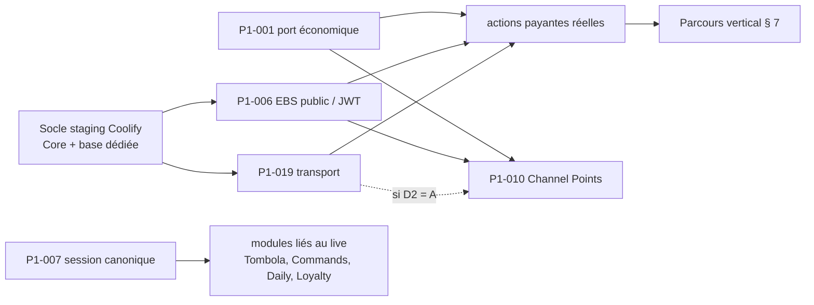

# Plan de cutover Raptoru 2.0 — préparation (octobre 2026)

**Statut :** référence canonique de la phase **préparation du cutover**, ouverte le 05/10/2026.
**Point de départ vérifié :** `main@9ab0523`, arbre propre (vérifier `git log` avant de se fier à ce SHA).
**Ce document n'autorise rien.** Aucun cutover, release, `studio:release`, déploiement, migration distante, écriture
en base de production, changement Twitch réel (récompenses, extension, EventSub), changement SAMMI ou StreamElements
sans validation explicite d'Antoni, étape par étape.

**Préparation OAuth (18/10/2026, local).** Le lot de fiabilisation après `9fae46e` prépare deux profils fixes de six
scopes et leur réautorisation depuis **Studio → Connexions** : [`TWITCH_OAUTH.md`](TWITCH_OAUTH.md). Aucun token réel
ni consentement n'a été changé pendant son développement. Les anciennes instructions liant la demande de droits aux
flags sont historiques ; les flags continuent de sélectionner les fonctionnalités. Cette préparation ne réalise ni
le transfert de propriété des récompenses (D7), ni le démarrage du bot de production, ni la bascule EventSub.

Statut de tous les modules et roadmap : [`../Raptoru-2.0-ETAT-PROJET.md`](../Raptoru-2.0-ETAT-PROJET.md) § 0 · registre de
l'audit : [`ASTRA_GLOBAL_AUDIT_2026-10.md`](ASTRA_GLOBAL_AUDIT_2026-10.md) · reprise rapide :
[`../Raptoru-2.0-HANDOFF.md`](../Raptoru-2.0-HANDOFF.md) · architecture cible :
[`../Raptoru Studio — Infrastructure Spec.md`](<../Raptoru Studio — Infrastructure Spec.md>).

> **Point d'étape 15/10/2026.** Bonk VNext Lots 0–3 validés localement sur `feat/compact-video-port` (détail :
> [`BONK_VNEXT_AUDIT_2026-10.md`](BONK_VNEXT_AUDIT_2026-10.md) § 0), **non déployés** : le staging reste sur
> `c7f20de`, le Hosted Test sur le ZIP `c7f20de4430a`, aucune release Studio, `main` intact. Le Lot 0 apporte au Core le
> sweep périodique et le refus `wrong_channel` du transport Studio → **au prochain déploiement : Core staging d'abord,
> puis Studio** (l'ancien Core refuse le champ `channel_id` du heartbeat), validation sur le staging, puis seulement
> décision de promotion.
>
> **Point d'étape 16/10/2026** (HEAD local `166e7ed`, rien de poussé ni déployé au-delà de `c7f20de`). Migrés et validés
> **en Lab** depuis : Jeu des mots, Roulette / Slot, Duel (réserves : `DUEL_PARITY.md`), unification `EconomyPort`
> (§ 4.1, Wallet Lab), alertes Twitch A1 / A2 (`TWITCH_ALERTS_PARITY_2026-10.md` § 16 : file durable, source OBS
> servie par Studio, aperçu — **non branchées** aux événements Twitch, **non testées dans OBS**). Aucun de ces modules
> n'est sur le staging (leurs migrations Lab n'y sont pas). Coexistence : SAMMI / StreamElements gardent les jeux et
> les alertes en production ; les sources d'alerte legacy ne seront neutralisées que lors d'une bascule contrôlée, et
> les abonnements EventSub d'alertes resteront au seul consommateur Raptoru 2.0 (P1-007).
>
> **Alertes V1, 17/10/2026 : développement terminé / prêt pour cutover / non déployé** (§ 13 ci-dessous). Module officiel préparé pour le profil Production (schéma `20261024120000_alerts.sql`
> non appliqué, routes `/v1/studio/alerts`, Studio multi-profil) ; prérequis, bascule par type, retour arrière et
> blocage (réception Twitch de production) : `TWITCH_ALERTS_PARITY_2026-10.md` § 22. Rien de déployé ni basculé.

---

## 1. État de départ

### Raptoru 2.0 (Lab consolidé)

- **Consolidation globale validée manuellement par Antoni le 05/10/2026.** Smoke test final : Hub, TTS réel (normal,
  STOP, second TTS ; un player OBS / preview est requis), Soundboard (lecture, STOP), Bonk (Unicode / local ; Twitch en
  rôle viewer lié), Tombola, Modération, Commands. L'ingestion Twitch réelle n'était pas un critère bloquant.
- Audit Astra : P0 = 0 ; P1 = 14 fermés + **5 bloqués pour le cutover** (001, 006, 007, 010, 019) ; P2 = 26 fermés + 3
  différés (015, 021, 025) ; P3 = 3 fermés / acceptés (003, 004, 005) + 3 ouverts volontairement (001 signature
  Windows, 002 nommage BonkLab, 006 backlog UX). Aucun des P2 / P3 ouverts ne bloque la préparation.
- _Mise à jour 06/10/2026 : un **Core staging** distant tourne sur Coolify (`https://core-staging.raptoru.fr`, base
  staging dédiée, aucune donnée réelle, aucun viewer) — ce n'est pas une production (§ 4.5)._
- Rien de Raptoru 2.0 ne tourne en production (aucune trace de déploiement dans le dépôt ni les documents) : aucun Core déployé, aucune base de production Raptoru 2.0, les flags
  économiques réels sont OFF (`DAILY_WALLET_CREDITS`, `LOYALTY_PASSIVE_CREDITS`, `LOYALTY_EVENT_CREDITS`,
  `LOYALTY_CHAT_COMMANDS`, `DAILY_CHAT_COMMANDS`). Dernière release Studio : 0.1.5 (Lab).

### Production actuelle (legacy, intacte)

| Brique                       | Rôle actuel                                                                                                  | Où                                                 |
| ---------------------------- | ------------------------------------------------------------------------------------------------------------ | -------------------------------------------------- |
| **StreamElements**           | Jetons = points SE (solde canonique aujourd'hui), gains passifs, subs, bits, jeux `!duel` / roulette / slots | SaaS SE                                            |
| **SAMMI** + bridge           | Exécution (Bonk, Soundboard, TTS, alertes, Tombola), Daily de production                                     | PC streamer                                        |
| **EBS legacy** + leaderboard | `https://raptoru.fr/api` : JWT Extension, redemptions Channel Points, holds sur les points SE, file SAMMI    | App Coolify `leaderboard--jeu-des-mots` + Supabase |
| **Extension publiée**        | Version `20260920-095259Z-consolidated-final`, `apiBase` = `https://raptoru.fr/api`                          | Twitch CDN                                         |
| Wizebot                      | Emote-only, annonces                                                                                         | SaaS                                               |

Vercel est **historique** et ne fait pas partie de la cible : cible = **VPS Coolify** (+ Supabase / Postgres sur le
VPS quand c'est pertinent).

---

## 2. Objectifs

1. Transformer le Lab consolidé en un **chemin future-prod testable et réversible**, en parallèle de la production.
2. Lever les cinq P1 de cutover **dans un ordre dérivé des dépendances réelles du code**, chacun validé isolément.
3. Construire d'abord **un seul parcours vertical représentatif** (§ 7) avant de raccorder les autres modules.
4. Préparer un cutover **par étapes**, jamais big-bang, avec une procédure de retour arrière à chaque étape.

## 3. Contraintes

- SAMMI + StreamElements + EBS legacy restent la production jusqu'à un cutover explicitement décidé.
- **Un seul écrivain par monnaie à tout instant** : tant que SE est canonique, aucun débit / crédit réel de Jetons
  n'a lieu dans le Core ; au cutover, l'ancien chemin est coupé **avant** que le nouveau soit activé.
- Les gardes du Lab ne sont **jamais assouplies** : Core Lab en loopback et base Lab au nom contrôlé
  ([`local-server.ts`](../apps/core-api/src/bonk-lab/local-server.ts)), contraintes SQL `test_mode` /
  `payment_mode = 'simulated'` / `real_debited = 0`, lecteurs qui refusent tout ce qui n'est pas simulé, jeton Lab non
  signé accepté uniquement par la façade LabEbs. Le chemin production est **un chemin à côté**, pas un Lab débridé.
- Migrations : additives uniquement, jamais de réécriture d'une migration appliquée ; toute nouvelle migration est
  classée dans [`migration-scopes.ts`](../apps/core-api/src/db/migration-scopes.ts).
- Pas de bus d'événements générique, pas de microservice supplémentaire, pas de moteur de workflow.
- Les données historiques StreamElements sont importées **à la toute fin**, juste avant le cutover économique.

---

## 4. Les cinq P1 de cutover — revalidation sur `9ab0523`

Méthode : relecture ciblée du code actuel (Core, Studio, Bot, Extension) et, en lecture seule, du code legacy
(`…\Raptoru\CANONICAL_WORKSPACE`). Aucun graphe complet du monorepo (Graphify non lancé : les frontières utiles tiennent
dans quelques fichiers, cités ci-dessous).

### 4.1 P1-001 — Wallet canonique / économie

**Raison historique.** Les modules V2 ont été construits sur un wallet de test Lab autonome (`lab_wallets`,
`lab_wallet_ledger`), distinct du Wallet Core (`WalletService`).

**Toujours vrai au HEAD.** Oui.

- Bonk, Soundboard, TTS débitent `lab_wallets` **dans la transaction d'admission**
  ([`store.ts` `debit()`](../apps/core-api/src/lab-moderation/store.ts), appelé par `bonk-lab-service.ts`,
  `sound-lab-service.ts`, `tts-lab-service.ts`) ; remboursement au plus une fois (`lab_wallet_ledger_once`).
- Tombola paie les gagnants dans `lab_wallet_ledger` (`raffle_win`) ; Commands V2 n'a pas de coût.
- `WalletService` ([`wallet-service.ts`](../apps/core-api/src/wallet/wallet-service.ts)) : idempotence forte, ledger
  immuable, verrous ciblés, multi-monnaie (`main` = Jetons), types `refund` et `opening_balance` prévus. **Mais
  `execute()` ouvre sa propre transaction (`this.db.tx`)** : il ne peut pas aujourd'hui partager la transaction d'une
  admission.
- Daily (`WalletCreditProvider`) et Loyalty créditent déjà via `WalletService`, derrière des flags OFF. Presence ne
  touche pas au Wallet (elle alimente Loyalty).

**Sources de vérité.**

| Question                | Réponse                                                                                                                                                                                                                                                                      |
| ----------------------- | ---------------------------------------------------------------------------------------------------------------------------------------------------------------------------------------------------------------------------------------------------------------------------- |
| Canonique aujourd'hui   | **Points StreamElements** (Jetons de production) ; les holds de l'EBS legacy portent sur ces points. Le Wallet Core n'a aucune donnée réelle ; le wallet Lab est fictif.                                                                                                     |
| Canonique après cutover | **Wallet Core** (`currencies` / `wallet_operations` / ledger), monnaie `main` = Jetons ; crédits de module selon la décision D2.                                                                                                                                             |
| À migrer                | Soldes SE au point de coupure → une opération `opening_balance` par viewer (clé `se-import:<cutoff>:<twitch_user_id>`) ; historique Daily legacy (outil `daily:import-legacy` existant, dry-run par défaut, aucun crédit).                                                   |
| À ne surtout pas migrer | Wallet / ledger / interactions Lab ; montants théoriques Presence / Loyalty (shadow, preview) ; historique transactionnel SE ligne à ligne (archivé à part, pas rejoué dans le ledger) ; holds / deliveries / redemptions en cours du legacy (vidés avant la coupure, § 10). |
| Import ou départ à zéro | Recommandation : **importer** les soldes SE (décision D1). Mapping SE `username` → `twitch_user_id` à résoudre et contrôler (renommages).                                                                                                                                    |

**Delta exact restant.**

1. Une variante transactionnelle du Wallet (`WalletService` exécuté **dans** la transaction de l'appelant), sans
   dupliquer ses règles — c'est le seul changement structurel du Wallet.
2. Un port économique unique côté Core, choisi par environnement : `LabEconomy` (wallet Lab actuel, inchangé, pour
   toujours dans le Lab) et `CoreWalletEconomy` (Wallet Core). Admission + débit **dans la même transaction**
   PostgreSQL ; remboursement = `credit(kind:'refund')` clé par `interaction_id`, dans la transaction du changement
   d'état de l'interaction.
3. Un schéma d'interactions de production (les tables Lab interdisent tout autre mode par contrainte SQL) : migrations
   additives en scope `prod` uniquement ; la base Lab garde ses contraintes.
4. L'outil d'import SE (dry-run + rapport de contrôle), exécuté seulement au cutover économique.

**Frontière atomique.** `BEGIN` → idempotence de l'admission (clé par viewer, empreinte de requête — déjà en place) →
règles du module (modération, cooldown, pause) → **débit Wallet** → insertion de l'interaction → `COMMIT`. Jamais un
`WalletService.spend()` séparé de l'admission : ce découplage est précisément le risque décrit par le finding.

**Double débit / crédit en phase hybride.** Impossible par construction si la règle « un seul écrivain » est tenue :
pendant la préparation, le Wallet Core de staging ne contient que des soldes de test (base distincte) ; aucun pont
SE ↔ Core n'est construit ; les flags de crédit restent OFF en production.

**Dépendances.** Aucune pour être développé (interne au Core, testable sur base jetable). Requis par P1-010 (crédits)
et par toute interaction payante réelle (parcours § 7).

**Données de production impliquées.** Soldes SE (lecture seule jusqu'au cutover), tables Wallet Core de la future base
de production (vides aujourd'hui).

**Rollback.** Avant le cutover économique : rien à défaire (base staging). Après : fenêtre de retour arrière définie
(premier stream) avec export des soldes Core → SE (opération inverse de l'import, dry-run d'abord) ; au-delà, retour
arrière non supporté.

**Validation isolée.** Tests sur PostgreSQL jetable : échec d'admission après débit → solde intact ; retries et
appels concurrents → un seul débit ; remboursement unique ; réconciliation solde / ledger ; import SE en dry-run sur
un export réel anonymisé ou réduit.

#### Lot 1 — débit économique et admission atomiques (05/10/2026, `1e86d96`, `ad2be7f`, `a69dd19`) : FAIT, tests automatiques verts

**Audit.** `WalletService.execute()` ouvrait sa propre transaction (`this.db.tx`) et écrivait `viewers` hors
transaction : impossible de composer un débit du Wallet canonique avec une admission. Les admissions Bonk /
Soundboard / TTS (`admitTx`, une transaction chacune) débitaient déjà le wallet de test Lab dans leur transaction
(`store.debit`) et remboursaient au plus une fois (`refundDebit`, garde `refund_status`). Tombola : gains dans le ledger
Lab (hors admission). Commands : aucun coût.

**Fait.**

- `WalletService` : corps d'opération extrait en `apply(q, …)` ; `spend()` / `credit()` publics inchangés (leur propre
  transaction) ; **`spendIn(q, …)` / `creditIn(q, …)`** appliquent la même opération (clé idempotente, verrous, plan,
  ledger) **dans la transaction de l'appelant**, sans en ouvrir ; ligne `viewers` créée si absente, jamais réécrite.
- **`EconomyPort`** (`apps/core-api/src/economy/economy.ts`) : `debit(q, …)` / `refund(q, …)` dans la transaction de
  l'admission ou de la décision de remboursement.
  - `labEconomy` : wallet de test Lab actuel — **défaut partout, Lab inchangé**.
  - `coreWalletEconomy(wallet)` : Wallet canonique, Jetons (`main`) ; clé `interaction:<id>:debit`, source = module,
    référence = interaction ; **tout résultat non appliqué lève une exception** (rien de l'admission n'est gardé, pas
    même un refus commité) ; remboursement = exactement le débit, une fois (clé `interaction:<id>:refund`), rien si
    aucun débit, un remboursement refusé annule la décision. Crédits TTS / sons : refusés (`economy_unavailable`)
    tant que leur modèle n'est pas décidé (D2).
- Services Bonk / Soundboard / TTS : paramètre `economy` optionnel (défaut `labEconomy`) ; plus d'appel direct au
  wallet Lab. Aucune migration.

**Revue finale (corrigée dans `a69dd19`).** Les remboursements automatiques (expiration, échec avant affichage)
passent sous savepoint : un refus économique est différé (`refund_status` reste `none`, remboursable plus tard) au
lieu de bloquer la file du canal ; les routes Bonk / Soundboard traduisent les refus économiques en 409 (500
auparavant, préexistant) ; tests ajoutés (rollback exact d'une ligne viewer, annulation avec remboursement
Soundboard, remboursement refusé puis accepté, remboursement automatique différé, 409 HTTP).

**Preuves.** `economy-core-wallet` (12, PGlite) : solde suffisant → un débit + admis ; insuffisant → rien, aucun refus
commité, nouvel essai après crédit accepté ; débit puis erreur dans la même transaction → rollback complet (solde,
`wallet_operations`, `wallet_transactions`, interaction, viewer) ; rejeu / même clé autre contenu / doublon concurrent →
un seul débit ; remboursement unique et exact, jamais débité → rien ; cycle ACK inchangé ; Soundboard / TTS Jetons
atomiques, crédits refusés ; défaut Lab intact. `economy.integration` (PostgreSQL réel, base jetable, 2 connexions) :
8 requêtes parallèles même clé → 1 interaction, 1 débit ; 10 requêtes parallèles sur un solde de 3 → exactement 3,
solde jamais négatif. Suites : Core 400 (`--maxWorkers=3`), intégration PostgreSQL 13, Studio server 199 (crash Windows connu `0xC0000409` une fois sous charge, vert en relance) ; lint,
typecheck, build.

**Unification économique des modules via `EconomyPort` (16/10/2026, Lab uniquement, aucun cutover).** Le port gagne
trois mouvements, toujours **dans la transaction de l'appelant** : `hold` (verrouille les Wallets dans l'ordre des
IDs, lit soldes et plafond), `move` (un mouvement signé + sa ligne de ledger ; refus avant toute écriture :
`CurrencyCreditError` au crédit, `LabWalletError` au débit) et `transfer` (viewer → viewer, deux lignes, somme nulle).
Raccordés : **Jeu des mots** (crédit unique par message), **Roulette / Slot** (verrou, plafond avant tirage, une
variation), **Duel** (verrou des deux Wallets, transfert atomique perdant → gagnant), **gains Tombola** (crédit dans la
monnaie de la manche, ligne `raffle_win` unique). Plus aucune écriture directe dans `lab_wallets` /
`lab_wallet_ledger` dans ces modules ; seules deux **lectures** Tombola restent (« ce gagnant est-il déjà payé ? » et
la fiche de manche) — à transposer au raccordement canonique. Comportement inchangé : `labEconomy` reste le défaut ;
`coreWalletEconomy` **refuse explicitement** `hold` / `move` / `transfer` (`economy_unavailable`,
`canonical_not_wired`) tant que P1-001 lot 2 ne les branche pas. Preuves : `economy-movements` (14, PGlite : crédit /
débit exacts, solde insuffisant, plafond, même clé, rollback métier, Tombola, concurrence, transfert somme nulle /
émetteur insuffisant / receveur au plafond / croisés, refus canonique) ; suites Jeu des mots, mini-jeux, Duel, Tombola
inchangées et vertes ; Core 648 (`--maxWorkers=4`) ; tests Studio adossés au Core (Bonk, Sons, TTS, Tombola,
Modération) 47.

**Reste de P1-001 (non fermé).** Décision D1 (import des soldes SE / point de coupure) et outil d'import (dry-run,
contrôle) ; modèle des crédits TTS / sons (D2) ; schéma d'interactions de production (les tables Lab imposent
`payment_mode = 'simulated'`, `real_debited = 0`) et contrat des lecteurs pour un paiement réel ; branchement d'un
runtime sur `coreWalletEconomy` (aucun aujourd'hui) ; cutover économique unique (§ 10). **Toujours simulé** : toutes les interactions (Lab et Production locale), le wallet de test Lab ; le
Wallet canonique n'est utilisé que par les tests.

### 4.2 P1-006 — EBS public / identité Twitch

**Raison historique.** Les surfaces V2 passent par la façade LabEbs locale, avec des identités simulées.

**Toujours vrai au HEAD.** Oui.

- [`lab-ebs.ts`](../apps/studio/server/src/extension-lab/lab-ebs.ts) accepte un jeton `lab.<base64>` **non signé**
  ([`twitch-mock.ts`](../apps/studio/server/src/extension-lab/twitch-mock.ts)) ; rôles viewer / moderator /
  broadcaster fictifs (900101 / 900102 / 900100) ; seul le rôle viewer devient le compte Twitch lié (règle confirmée et
  rendue visible par `9ab0523`).
- Le Core ne connaît que trois niveaux d'authentification ([`server.ts`](../apps/core-api/src/http/server.ts)) :
  `public`, `bot` (`BOT_SECRET`), `studio` (`STUDIO_SECRET`). Les admissions viewer (ex.
  `POST /v1/lab/bonk/interactions`) sont des routes `studio` où **l'identité du viewer est dans le corps** : acceptable
  derrière LabEbs en loopback, **inacceptable** sur une frontière publique.
- Aucun code de vérification de JWT Twitch dans Raptoru 2.0. Le legacy en a un, éprouvé
  (`CANONICAL_WORKSPACE/extension/ebs/core/identity.js` `verifyExtensionJwt` : HS256 uniquement, clé = secret
  d'extension décodé base64, `user_id` numérique seulement si l'identité est partagée, `opaque_user_id` jamais traité
  comme une identité).
- L'Extension vise toujours `https://raptoru.fr/api` (`runtime-config.js`) ; aucun rate limiting dans le Core.
- Déjà en place et réutilisable : idempotence d'admission par `(channel, viewer, clé)` avec empreinte de requête ;
  droits Modération V2 / Commands réévalués par Core à chaque action ; projection publique Commands sans donnée
  interne.

**Frontière publique minimale.** Le Core (app Coolify, HTTPS) expose un préfixe dédié aux viewers, par exemple
`/v1/ext/*`, qui reprend **le contrat que l'Extension parle déjà à LabEbs** (`/session`, `/state`, `/emotes`,
`/actions/tokens`, `/actions/redemption`, `/moderation/v2/*`, `/commands/v2/*`, `/raffle/state`) : l'Extension ne
change que d'`apiBase`. Chaque requête :

1. vérifie le JWT d'Extension (HS256, `exp`, `channel_id` = chaîne configurée, rôle connu) ;
2. dérive l'acteur **uniquement du JWT** : `user_id` si l'identité est partagée, sinon lecture seule ; rôle Twitch du
   JWT ; rôles internes (supermod, permissions D4) depuis les tables Core ;
3. applique un rate limit par `user_id` (ou `opaque_user_id` en lecture) et par IP ;
4. exige `Idempotency-Key` sur toute mutation (déjà envoyé par `api.js`) ;
5. n'accepte jamais d'identité, de rôle, de prix ou de canal fourni par le client.

Les routes `studio` et `bot` refusent tout JWT d'Extension ; les routes `/v1/ext/*` refusent tout secret
Studio / Bot. Les routes `/v1/lab/*` ne sont jamais montées par le Core de production public (aujourd'hui
`index.ts` monte encore Bonk / Soundboard / TTS Lab : à retirer du bootstrap public au moment du raccordement).

**Secrets côté serveur uniquement.** Secret d'extension, client secret de l'app Twitch, tokens broadcaster / bot /
viewer (OAuth emotes), URL de base, identifiants Studio et Bot. **Jamais dans l'Extension** : aucun secret, aucun
solde, prix, rôle ou droit présenté comme vérité, aucune décision métier.

**Compatibilité.** Les services Core actuels restent ; seule l'entrée change (JWT → acteur au lieu de « viewer dans le
corps »). La façade LabEbs reste pour le Lab.

**Dépendances.** Besoin d'un Core joignable en HTTPS (socle staging, § 6 étape 0) ; P1-001 pour toute action payante
(une version lecture seule ou à paiement simulé peut précéder) ; partage le socle de déploiement avec P1-019.

**Données de production impliquées.** Secret de l'extension publiée (le même pour toutes ses versions), identités
viewers réelles.

**Rollback.** L'Extension publiée n'est pas touchée pendant la préparation ; les tests passent par une version de
test (décision D4). Au cutover : retour à la version publiée précédente (`apiBase` legacy) tant que l'EBS legacy
tourne.

**Validation isolée.** Tests Core : JWT invalide / expiré / mauvais canal / identité non partagée / rôle forgé / cible
d'un autre viewer / droit retiré après ouverture → refusés. Puis parcours § 7 avec de vrais JWT d'une version de test.

**Lot 1 minimal — frontière viewer staging (06/10/2026, `482fc2e` + Extension `6660291` / `1e6236a`, déployé `44c895c`).**
Livré et vérifié sur le staging réel ; **premier live réel validé manuellement par Antoni le 07/10/2026** (Hosted
Test → Core staging → Studio → OBS, paiement simulé) ; complété le 14/10/2026 par l’OAuth emotes viewer (`6d7d381`,
`c7f20de`, déployé). P1-006 **non fermé**. Procédure du premier test réel :
[`TEST_REEL_STAGING_2026-10.md`](TEST_REEL_STAGING_2026-10.md).

- `/v1/ext/*` sur le Core : JWT d'Extension vérifié par le Core (HS256, secret base64, `exp`, chaîne configurée
  `TWITCH_CHANNEL_ID`), acteur dérivé du seul JWT, rate limit par IP puis par viewer, CORS `*.ext-twitch.tv`,
  Idempotency-Key exigée. Même contrat que LabEbs (session, state, actions, TTS, Tombola, console D4), servi par les
  services du Core via un appel interne : les routes `/v1/lab/*` ne sont plus servies par le bootstrap public.
- Paiement **simulé** : Wallet de test Lab (12 000 Jetons fictifs par viewer), aucun mode Points de chaîne proposé
  (`unsupported_payment`), aucun Wallet canonique, aucun StreamElements.
- Build Extension **STAGING** (`npm run build:staging -w @raptoru/twitch-extension`) : `apiBase` =
  `https://core-staging.raptoru.fr/v1/ext`, badge « STAGING · test », refus si une URL legacy subsiste, ZIP Hosted
  Test déterministe + SHA-256. Décision D4 prise par Antoni le 06/10/2026 : **Hosted Test** (comptes testeurs), jamais
  une release.
- Noms des viewers : Helix (app Twitch Raptoru 2.0, lecture seule) ; sans app, libellé neutre.
- **Reste** : vrai secret d'Extension (secret de test aujourd'hui), version Hosted Test dans la console (faite le
  07/10/2026), emotes Twitch personnelles (OAuth viewer — 15/10/2026 : sur `/v1/ext`, déployé au staging en `c7f20de`,
  validé en Hosted Test le 14/10 sauf l'affichage overlay), Commands, Points de chaîne réels (P1-010), paiement réel (P1-001), deux migrations Lab
  manquantes au staging pour Tombola et les actions de modération de l'Extension (appliquées depuis, voir le
  HANDOFF).

### 4.3 P1-007 — Session de stream canonique

**Raison historique.** Deux modèles persistants : `stream_sessions` (Daily, Presence, Loyalty) et
`lab_stream_sessions` (Tombola, Commands V2).

**Toujours vrai au HEAD.** Oui, mais l'écart est plus petit que ne le laissait penser l'audit initial.

- `stream_sessions` ([`stream-sessions.ts`](../apps/core-api/src/stream/stream-sessions.ts)) est **déjà un modèle
  canonique mûr** : identité = `stream_id` Twitch ; `online` idempotent ; un `offline` erroné suivi du même `stream_id`
  rouvre la session ; une session restée ouverte est fermée par un nouveau live ; une seule session ouverte (index
  unique) ; fin rattrapée datée de la dernière confirmation (`reconciledEnd`, jamais « maintenant » après une longue
  panne) ; `stream_day` (16:00 Europe/Paris) partagé par les lives du même jour. Alimentée par le bot principal
  (`createStreamWatcher` : EventSub + Helix au démarrage et périodiquement, échec Helix jamais interprété comme
  offline).
- `lab_stream_sessions` : UUID, `source` `simulated` / `twitch`, **sans `stream_id` Twitch** ; alimentée par le
  processus labchat (`/v1/lab/stream`, réparation périodique depuis `47b71bd`) ou simulée depuis Studio. Lue par Tombola
  (`raffle-lab-service.ts` `liveSession` / `streamEvent`, planificateur lié à la session) et Commands V2
  (`commands/admission.ts`, fenêtre « pendant le live » et quotas).
- Deux processus EventSub distincts suivent l'état du stream (bot principal, labchat) : en production il n'en faut
  qu'un.

**Modèle minimal canonique.** **`stream_sessions` est la session canonique** ; aucun nouveau modèle.

| Point                           | Règle                                                                                           |
| ------------------------------- | ----------------------------------------------------------------------------------------------- |
| Identité                        | `stream_id` Twitch                                                                              |
| Début                           | `started_at` Twitch (EventSub `stream.online` ou Helix)                                         |
| Fin                             | `stream.offline`, ou rattrapage Helix confirmé offline (fin = dernière confirmation si tardive) |
| Reconnexion même `stream_id`    | même session (rouverte si fermée à tort)                                                        |
| Reconnexion nouveau `stream_id` | nouvelle session, **même `stream_day`** si même journée                                         |
| Redémarrage Core / Bot          | état relu depuis la base ; Helix au démarrage du bot                                            |
| EventSub manqué                 | réparation Helix périodique                                                                     |
| API Twitch indisponible         | état inchangé (jamais « offline » par défaut)                                                   |
| Lab                             | les sessions simulées restent explicites (`source = simulated`), uniquement en base Lab         |

**Delta restant.** En production, Tombola et Commands lisent la session canonique (référence `stream_id`, ou
`stream_day` pour « ce stream » selon D5) au lieu de `lab_stream_sessions` ; un seul consommateur EventSub d'état de
stream (le bot principal) ; migration additive (ex. référence à `stream_sessions` dans les tables de production des
modules), jamais de réécriture.

**Dépendances.** Indépendant des autres P1 pour être développé. Doit précéder la mise en production de tout module
lié au live (Tombola automatique, Commands « pendant le live », Daily, Loyalty passif). **N'est pas requis** par le
parcours vertical Bonk (§ 7).

**Données de production impliquées.** Futur `stream_sessions` de production (alimenté en shadow par le bot principal
avant le cutover si Antoni l'autorise ; Presence shadow l'a déjà fait en test réel le 25/09/2026).

**Rollback.** Les modules gardent leur lecture actuelle dans le Lab ; en production, la lecture de la session est un
adaptateur unique, réversible tant que les modules ne sont pas activés.

**Validation isolée.** Tests Core : même stream reçu plusieurs fois → une session ; offline perdu / reconnexion /
redémarrage → fin cohérente ; deux lives le même jour → même `stream_day` ; manche manuelle hors stream → aucune
session réelle ouverte. Puis shadow du bot principal en lecture seule sur la vraie chaîne (déjà pratiqué).

#### Lot 1 — une session par live Twitch pour Tombola et Commands (05/10/2026, `0385223`, `59d153d`) : FAIT, tests automatiques verts

**Audit.** `stream_sessions` (base de production) est déjà le modèle canonique mûr (identité = id de stream Twitch,
online idempotent, reconnexion, offline perdu rattrapé, `stream_day` dérivé à part) et alimente Daily / Presence /
Loyalty. Tombola et Commands lisent `lab_stream_sessions` (base Lab), sans id Twitch, avec deux interprétations
locales. Défauts constatés : un nouveau live réutilisait une session restée ouverte (offline perdu) ; une reconnexion
créait une nouvelle session (quotas « pendant le live » remis à zéro) ; un offline Twitch fermait une simulation ;
une simulation ouverte bloquait la vraie session ; Commands relisait la table à sa façon. Deux consommateurs EventSub
d'état de stream (bot principal → `stream_sessions`, labchat → `lab_stream_sessions`), jamais sur la même base. Le
`lab_session_id` des interactions Bonk / Soundboard / TTS est la session du worker Studio, pas une session de stream.

**Fait.**

- Migration additive Lab `20261016130000_lab_stream_session_twitch_id.sql` : `twitch_stream_id` (réservé aux sessions
  Twitch) + index unique partiel `(channel_id, twitch_stream_id)`.
- `apps/core-api/src/stream/channel-sessions.ts` : **un seul lecteur** (session ouverte d'abord, sinon la dernière)
  pour Tombola **et** Commands, et **un seul verrou de session par chaîne** (verrou consultatif pris en premier par
  tout écrivain : événements Twitch, simulation Studio, configuration Tombola).
- Règles (mêmes que `stream_sessions`) : même id → même session (rouverte après un offline, planificateur relancé) ;
  id nouveau → la session restée ouverte est fermée puis une nouvelle s'ouvre ; un live plus ancien livré en retard est
  ignoré sans rien fermer ; une session enregistrée sans id adopte l'id (sauf s'il désigne déjà une autre session) ;
  offline → ferme seulement la session Twitch (jamais une simulation) ; une simulation est remplacée proprement par un
  vrai live ; manches hors live sans session. `stream_sessions` / `stream_day` (Daily, Presence, Loyalty) inchangés.

**Preuves.** `channel-sessions` (12, PGlite : online / doublons / offline, reconnexion, offline perdu + live tardif,
redémarrage + synchro de démarrage, démarrage alors que déjà live, session sans id, simulations, offline tardif,
lecteur, adapters mixtes, `stream_sessions` intacte) ; Commands (fenêtre « pendant le live » sur reconnexion / nouveau
live / simulation fermée). **PostgreSQL réel** (`channel-sessions.integration`, base jetable, 3 connexions) : 12
« online » concurrents du même live → une session (échoue avec `lab_stream_sessions_one_live` si le verrou est retiré) ;
lives concurrents + offline + simulation → jamais deux sessions ouvertes, jamais deux sessions pour un live, seulement
des refus métier. Suites : Core 414 (`--maxWorkers=3`), intégration PostgreSQL 15, Studio server 199, Desktop 20,
Bot 98, Extension 38 ; lint, typecheck, build.

**Limite acceptée.** `stream.offline` ne porte pas d'id : un offline tardif d'un live précédent ferme le live courant ;
la reconnexion / la réparation périodique (P1-003) le rouvre (testé).

**Reste de P1-007 (non fermé).** Frontière Production : en production, Tombola et Commands devront lire la session
canonique `stream_sessions` (une seule table de sessions par base) et le bot principal rester l'unique consommateur
EventSub d'état de stream ; `lab_stream_sessions` reste la table du Lab (simulations comprises). Ce raccordement
appartient au passage de ces modules en production / staging (P1-019 / P1-006).

### 4.4 P1-010 — Channel Points réels

**Raison historique.** Les paiements « crédits » du Lab sont simulés ; aucun cycle de redemption V2.

**Toujours vrai au HEAD.** Oui.

- Aucun abonnement `channel.channel_points_custom_reward_redemption.*` dans le bot ; les lecteurs Soundboard / TTS
  refusent tout ce qui n'est pas `test_mode` + `payment_mode = 'simulated'`.
- Le Lab modélise les crédits comme des soldes (`lab_wallets.credits_tts`, `credits_soundboard`) que LabEbs présente à
  l'Extension sous forme de « redemptions en attente » (`/actions/redemption`).
- Legacy en production (`CANONICAL_WORKSPACE/extension/ebs/core/redemptions.js`) : récompense native Twitch →
  EventSub enregistre la redemption `UNFULFILLED` → l'Extension la liste → consommation atomique (appartenance, type,
  non expirée, non utilisée) → SAMMI → `FULFILLED` après confirmation, sinon récupérable puis `CANCELED` (points
  rendus) après `MAX_ATTEMPTS`.

**Trois notions à ne jamais confondre.**

| Notion                                | Propriétaire                                  | Remboursement                           |
| ------------------------------------- | --------------------------------------------- | --------------------------------------- |
| **Channel Points Twitch**             | Twitch (jamais détenus par Raptoru)           | uniquement `CANCELED` sur la redemption |
| **Jetons Raptoru**                    | Wallet Core (après cutover ; SE avant)        | ledger `refund`                         |
| **Crédits Raptoru** (TTS, Soundboard) | consommables de module issus d'une redemption | selon D2                                |

**Ce qu'il faudra.** Abonnement redemption dans le bot principal (seul consommateur EventSub) ; token broadcaster
`raptoru_` avec `channel:read:redemptions` / `channel:manage:redemptions` (non autorisé aujourd'hui) ; référence
stable `redemption_id` ; idempotence à la réception (redelivery EventSub) ; transitions persistées (reçue →
convertie ou admise → `FULFILLED` / `CANCELED`) ; reprise après crash ; mapping récompense → module en configuration
Core ; `FULFILLED` / `CANCELED` retentables et idempotents.

**Contrainte Twitch structurante (à reconfirmer à l'implémentation).** Seule l'application Twitch qui a **créé** une
récompense peut changer le statut de ses redemptions. Les récompenses actuelles appartiennent à l'application legacy :
l'application Raptoru 2.0 ne pourra pas les `FULFILLED` / `CANCELED`. Au cutover, il faut donc soit créer de
nouvelles récompenses avec l'application Raptoru 2.0 (et désactiver les anciennes), soit utiliser l'application legacy
(décision D2). Pendant la phase hybride, EventSub livre les redemptions à **tous** les abonnés : Raptoru 2.0 ne doit
jamais agir (fulfill / cancel / crédit) sur une redemption réelle.

**Dépendances.** P1-001 (les crédits sont une monnaie ou un paiement du Core), P1-006 (l'Extension liste et consomme
avec une identité vérifiée), bot principal comme consommateur EventSub unique ; P1-019 seulement si D2 = A (statut
décidé après l'ACK d'exécution). **Dernier P1 à raccorder.**

**Données de production impliquées.** Récompenses Twitch réelles, redemptions en attente, points des viewers.

**Rollback.** Récompenses Raptoru 2.0 en pause / désactivées → les récompenses legacy reprennent (tant qu'elles
existent) ; aucune redemption Raptoru 2.0 laissée `UNFULFILLED` sans décision (vidage avant retour).

**Validation isolée.** Mock EventSub + Helix (Twitch CLI ou faux serveur) : redelivery → un seul crédit ; crash entre
réception, crédit et `FULFILLED` → reprise sans double effet ; refus Helix → retenté ; résultat ambigu → politique
explicite, jamais un remboursement supposé certain. Un essai réel (récompense de test en pause hors live, coût
minimal, rachetée par Antoni) seulement sur décision d'Antoni.

### 4.5 P1-019 — Transport Studio ↔ Core de production

**Raison historique.** Transport et contrats d'exécution conçus pour l'isolement Lab.

**Toujours vrai au HEAD.** Oui, et c'est voulu.

- Clients Studio loopback uniquement, préfixes `/v1/lab/*` (`localLabCoreClient`
  [`proxy.ts`](../apps/studio/server/src/lab-moderation/proxy.ts), `localCoreClient`
  [`bonk-lab/worker.ts`](../apps/studio/server/src/bonk-lab/worker.ts) et équivalents Sound / TTS) ;
  `LAB_CHAT_CORE_URL` loopback ([`lab-chat-main.ts`](../apps/twitch-bot/src/lab-chat-main.ts)) ; lecteurs
  `simulated` uniquement.
- Un seul secret partagé `STUDIO_SECRET` couvre à la fois le cockpit (wallet admin, staff, modération), les workers
  (claim / ACK) et, dans le Lab, les admissions viewer.

**Déjà résolu indirectement par les passes P1 / P2 (et transposable tel quel sur HTTPS).** Le protocole d'exécution :
journal local durable écrit **avant** l'envoi d'un effet (« Lost response => unknown, never replay ») ;
`studio_instance_id` + `attempt_id` + bail (lease) + heartbeat ; ACK `started` / `completed` / `failed` /
`execution_unknown` ; `expires_at` (pas d'effet périmé joué en retard) ; remboursement unique si jamais affiché ;
STOP répété jusqu'à `stopped` (P1-017) ; garde de fin des lecteurs (P2-028) ; `WorkerLoop` (P2-017) ; `/ready`
(P1-005) ; erreurs Core journalisées (P2-013) ; réponses validées (P2-003) ; timeouts bornés (P2-010).

**Définition cible.**

| Sujet          | Règle                                                                                                                                                                                                                          |
| -------------- | ------------------------------------------------------------------------------------------------------------------------------------------------------------------------------------------------------------------------------ |
| Sens           | Studio → Core uniquement (sortant HTTPS) : rien n'est exposé sur le PC. Polling `claim` actuel conservé (`WorkerLoop` : 150 ms en activité, 1 s au repos, par worker) ; pas de Realtime requis.                                |
| Auth Studio    | Identifiant **par installation**, émis par le Core lors d'un appairage confirmé par Antoni, révocable, stocké côté Node (jamais dans le renderer), lié au `studio_instance_id`. Remplace le secret partagé pour la production. |
| Périmètre      | Routes `studio` séparées en cockpit (broadcaster) et exécution (claim / ACK / heartbeat) ; un JWT d'Extension ou un navigateur n'y a jamais accès (pas de CORS, pas de cookie, secret absent du front).                        |
| Version        | En-tête de version de protocole à chaque appel ; Core refuse une version incompatible avec une erreur explicite → Studio affiche « mise à jour requise ».                                                                      |
| Internet tombe | Studio ne réclame plus rien ; les interactions admises expirent (`expires_at`) et sont remboursées une fois si jamais affichées ; les ACK en attente restent dans le journal et partent au retour.                             |
| Studio tombe   | Au redémarrage : effet possiblement envoyé → `execution_unknown`, jamais rejoué ; jamais envoyé → rendu au Core.                                                                                                               |
| Core tombe     | Les admissions échouent tout de suite côté Extension (pas de file client) ; Studio réessaie avec backoff ; ACK idempotents par `attempt_id`.                                                                                   |
| Rejeu          | Autorisé : ACK, heartbeat, claim (idempotents). Interdit : tout effet dont l'envoi a pu commencer.                                                                                                                             |
| Lab            | Clients, préfixes et gardes Lab **inchangés** ; le chemin production est un client distinct (profil Studio, D6).                                                                                                               |

**Dépendances.** Socle staging (Core joignable en HTTPS). Indépendant de P1-001 / P1-006 / P1-007 pour être
développé (fonctionne avec un paiement simulé). Requis par toute exécution réelle.

**Données de production impliquées.** Aucune donnée économique ; identifiants Studio et file d'interactions.

**Rollback.** Profil Lab intact à tout moment ; le profil production se désactive sans toucher au Lab ; identifiant
révocable côté Core.

**Validation isolée.** Core local derrière TLS puis Core staging : déconnexion / retour réseau, ACK perdu, redémarrage
Studio pendant un effet, mauvaise instance ou identifiant révoqué refusés, version incompatible refusée, aucun rejeu.

#### Lot 1 — transport future-prod local (05/10/2026, `fe7d524` → `5b6fc49`) : FAIT, tests automatiques verts

**Lot 1 validé manuellement par Antoni le 05/10/2026** : smoke de non-régression dans `npm run studio`, OBS / player ouvert — Bonk Unicode OK, Bonk Twitch en rôle viewer lié OK, Soundboard OK, STOP Soundboard OK, TTS OK, STOP TTS OK, second TTS OK ; aucun comportement Lab dégradé observé.

**Fait.**

- **Identité d'installation** (`apps/studio/server/src/prod-transport/installation.ts`) : UUID + secret de 256 bits
  générés une seule fois par installation (jamais dérivés de la machine, de l'utilisateur ou de Twitch), fichier JSON
  côté serveur Node de Studio (écriture atomique, jamais réécrit ; fichier abîmé → arrêt, jamais de régénération
  silencieuse), secret invisible en JSON / `inspect`. Code d'appairage = `installation_id.sha256(secret)` : il ne
  permet pas de s'authentifier.
- **Côté Core** (`apps/core-api/src/studio/installations.ts`, migration additive `20261016120000_studio_installations.sql`,
  scope `prod`) : seule l'empreinte SHA-256 du secret est stockée ; authentification `Bearer rsi_<id>.<secret>`
  (analyse stricte avant toute requête SQL, travail identique pour un id inconnu, `timingSafeEqual`) ; révocation
  vérifiée à chaque appel (aucun cache) et qui termine le bail des livraisons Bonk en cours de l'installation (le
  sweep les passe en `execution_unknown`, jamais rejouées) ; `last_seen_at` écrit au plus toutes les 30 s.
  Outil opérateur local : `npm run studio:installation -w @raptoru/core-api -- pair <code> "<libellé>" | revoke <id> | list`.
- **Protocole** : en-tête `x-raptoru-studio-protocol` (version 1) sur chaque appel ; Core refuse une version absente ou
  non supportée **avant tout travail** : HTTP 426 `{ "error": "protocol_incompatible", "supported": [1] }`. Studio
  affiche « Mise à jour requise : protocole Studio N incompatible (Core accepte 1) ».
- **Routes d'exécution** `/v1/studio/session` (poignée de main), `/v1/studio/bonk/studio/heartbeat`, `/claim`,
  `/interactions/:id` (lecture limitée aux interactions de l'installation, sinon 404), `/interactions/:id/ack` :
  accessibles **uniquement** avec un identifiant d'installation (ni `STUDIO_SECRET`, ni JWT d'Extension) ; l'instance
  Studio est l'installation authentifiée (un corps qui en nomme une autre → 403 `studio_instance_mismatch`). Mêmes
  services claim / ACK que le Lab (paiement toujours simulé). `createHandler()` permet de servir le Core en HTTPS.
- **Client Studio séparé** (`apps/studio/server/src/prod-transport/core-client.ts`) : HTTPS uniquement, vérification
  TLS par défaut de Node, CA de confiance **propre à ce client** (aucun contournement global), routes `/v1/studio/`
  seulement, redirections refusées, délai total borné, réponse bornée, erreurs typées (`protocol_incompatible`,
  `studio_unauthorized`, `studio_revoked`, `tls_rejected`, `core_unreachable`), jamais d'en-tête ni de secret dans un
  message.
- **Worker** : le même `BonkWorker` (journal, `execution_unknown`, aucun rejeu) avec `{ base: '/v1/studio/bonk',
studioId: <installation> }` ; les valeurs par défaut Lab sont inchangées. `WorkerLoop` accepte un signal `failed()`
  optionnel : Core injoignable + travail local en attente → backoff jusqu'à 1 s au lieu de 150 ms (non passé par les
  runtimes Lab : comportement Lab inchangé).
- **Clients, routes, gardes et Core Lab inchangés** (le Core Lab a son propre serveur et ne monte pas ces routes).

**Tests.** Core `test/studio-transport.test.ts` (7) ; Studio `test/prod-transport.test.ts` (13, Core réel PGlite servi
en **HTTPS** avec un certificat de test auto-signé `test/fixtures/tls`, approuvé par le seul client) : normal, TLS
réellement vérifié, mauvais identifiant, révocation, protocole incompatible, coupure avant claim, coupure après claim

- redémarrage Studio, ACK perdu, ACK jamais arrivés, Core muet (délai total), backoff borné, redémarrage (identité
  conservée), secret jamais exposé. Suites complètes : Core 386, Studio server 162, Bot 98, Extension 38, Desktop 20 ;
  lint, typecheck, build verts.

**Limites du lot 1.** Pas branché dans l'application Studio (profil production = décision D6) ; seul Bonk passe par
ce transport ; paiement simulé ; la porte « `lab_session_id` = session du worker » du `BonkWorker` est propre au Lab
(une interaction admise par l'EBS public n'aura pas cette session) ; aucun Core distant ni staging ; aucun rate
limiting (à brancher dans `createHandler`, avant l'authentification, par IP puis par installation) ; un secret volé
sur le PC reste utilisable jusqu'à révocation (pas de rotation automatique). Le Core de production monte désormais `/v1/studio/*` : la migration
`studio_installations` doit être appliquée (migrateur scope `prod`) avant tout déploiement de ce code. L'option `ca`
du client **remplace** les racines par défaut : à laisser vide derrière un certificat public.

**Reste de P1-019 (après lot 1).**

1. Câbler le profil production dans Studio (D6) : chemin du fichier d'identité dans les données Studio, affichage du
   code d'appairage et des erreurs typées (« mise à jour requise », « Studio révoqué »), runtime production à côté du
   runtime Lab, `failed()` branché.
2. Soundboard et TTS sur le transport (claim / ACK / STOP prouvé, P1-017) et contrat des lecteurs en mode production.
3. Séparer le cockpit (routes `studio` : wallet admin, staff, modération) de l'exécution : identifiant d'installation
   avec rôle, `STUDIO_SECRET` réservé au Lab / à l'admin serveur.
4. Appairage réel côté staging (opérateur sur le Core distant), révocation testée à distance.
5. Socle staging Coolify (étape 0) puis validation du transport contre le Core distant (TLS publique du reverse
   proxy, coupures réelles).
6. Rate limiting à la frontière, journalisation d'accès sans en-têtes `Authorization`.
7. Décision sur la porte `lab_session_id` quand les admissions viendront de l'EBS public (P1-006).

#### Lot 2 — profil Production dans Studio (D6) + Soundboard / TTS (05/10/2026, `4b5c1cf`, `d2854ed`, `a75ba24`, `5551ef3`, `8c2ab6d` + revue) : FAIT, tests automatiques verts, **VALIDÉ manuellement par Antoni (05/10/2026)**

**Lot 2 validé manuellement par Antoni le 05/10/2026** (profil Production local contre le Core de test HTTPS) : appairage OK ; Bonk, Soundboard + STOP, TTS + STOP + second TTS en Production OK ; Extension Lab indisponible en Production OK ; retour au Lab avec la preview actuelle complète OK ; `revoke <installation_id>` → Studio « Révoqué » OK. Le `overlay_not_ready` Bonk observé venait de la source OBS absente / inactive dans la scène, pas du transport. Correctifs trouvés pendant la validation, validés aussi : `ea1f3f8` (pas de fausse Extension Lab en Production), `8d7416c` (ressources statiques des lecteurs Production servies), `afa99c1` (carte « Lecteurs Production » dans Studio).

**D6 retenue** : une seule app Studio, deux profils exclusifs, **Lab par défaut**.

- **Profil persistant** (`<runtime>/profile.json`), lu **au démarrage seulement** : changer de profil = action explicite
  puis redémarrage supervisé du serveur Studio (jamais de bascule à chaud). Au démarrage, Production n'est restauré que
  si sa configuration passe les contrôles statiques (HTTPS, URL d'origine seule, certificat PEM lisible et non réseau,
  identité saine liée à ce Core) ; sinon **Lab + raison affichée**. Une panne réseau / révocation garde Production et
  affiche l'état.
- **URL du Core Production et CA de test** : uniquement par l'environnement du processus Studio
  (`RAPTORU_PRODUCTION_CORE_URL`, `RAPTORU_PRODUCTION_CA_FILE`), plus tard une constante de build ; **jamais saisies
  dans la page** (revue sécurité : une page ne peut pas envoyer l'identifiant ailleurs).
- **Identité liée au Core** : le fichier d'identité porte l'origine du Core et l'empreinte du CA ; le client refuse
  toute autre origine / autre CA (« Identité liée à un autre Core » → régénération explicite).
- **Changement de profil et régénération** : uniquement via Electron main (jeton par lancement transmis au serveur,
  jamais à la page ; dialogue natif nommant l'hôte ; redémarrage supervisé). Refusé si une interaction est en cours.
  La régénération (profil Lab seulement) **archive** `production/` en `production.replaced-<horodatage>` (jamais de
  suppression).
- **Production** : ni Core Lab, ni façade Extension Lab, ni cockpit / Tombola / Commands ; Bonk, Soundboard et TTS
  sur le client HTTPS du lot 1, journaux `production/<module>/journal.json` marqués `production` (un worker Lab les
  refuse ; Production refuse un journal Lab avec du travail), jetons de lecteurs distincts (URL OBS différentes par
  profil), `WorkerLoop` avec backoff sur échec, poignée de main toutes les 5 s. Même contrat lecteur : **pas de
  lecteur prêt = module indisponible** (heartbeats liés au runtime du profil actif).
- **Contrôle de session Lab** : ne s'applique qu'au Lab ; en Production, les admissions viendront de l'EBS public, la
  garde contre les effets périmés reste celle du Core (`expires_at`, baux, claim).
- **Core** : routes `/v1/studio/sound/*` et `/v1/studio/tts/*` (mêmes règles que Bonk) ; la révocation termine aussi
  les baux Soundboard / TTS.
- **Studio** : carte « Profil Studio » (onglet Studio) — profil actif, Core configuré, état (Non configuré, Non
  appairé, Connexion…, Connecté, Core inaccessible, Révoqué, Mise à jour requise, TLS invalide, Identité liée à un
  autre Core, Démarrage impossible), installation, code d'appairage + Copier ; jamais le secret. Bandeau supérieur =
  profil actif.
- **Outil de validation manuelle** : `npm run test:local-https-core -w @raptoru/core-api` — Core de test en mémoire
  (PGlite), HTTPS local avec le certificat de test, commandes `pair`, `revoke`, `bonk`, `sound`, `tts`, `stop-sound`,
  `stop-tts`, `status`. Jamais la production.

**Tests.** Studio `prod-profile` (18 : plan de démarrage, persistance, configurations invalides → Lab + raison,
identité abîmée / liée à un autre Core, table des états, API profil sans secret, code d'appairage non utilisable
comme identifiant, bascule réservée à Electron main, refus si occupé, régénération archivée, isolation journaux et
lecteurs), `prod-modules` (14 : Soundboard et TTS — normal, session EBS publique, STOP après coupure avec réponses
perdues, ACK perdu, redémarrage, révocation, protocole), `prod-transport` (13, lot 1 sur identité liée) ; Core
`studio-transport` (9). Suites : Studio server 194, Core 388 (`--maxWorkers=3`), Desktop 20, Bot 98, Extension 38 ;
lint, typecheck, build.

**Revues sécurité (Agent Skill, avant code et sur le diff final).** Avant code : l'URL du Core et le CA ne
viennent plus de la page (sinon l'identifiant pouvait partir vers un autre hôte), identité liée au Core, bascule et
régénération par Electron main avec dialogue natif, démarrage Production sous garde. Diff final (aucun point grave,
corrigés dans `8c2ab6d`) : jeton de main jamais hérité par les processus Lab enfants, workers arrêtés dès qu'une
bascule est acceptée (rien n'est réclamé avant le redémarrage), comparaison du jeton en octets. **Limites
acceptées** : (1) en Production, toute interaction réclamée est jouée, y compris une admission faite par les routes
Lab d'un Core qui servirait aussi `/v1/lab/*` sur la même base (c'est le cas du Core de test local, jamais d'un Core
de production — les routes Lab sortent du bootstrap public avec P1-006 ; fenêtre bornée par `expires_at`) ;
(2) une configuration Production invalide au démarrage retombe sur le Lab (état sûr par défaut, raison affichée).
**Bug préexistant constaté, non corrigé (hors lot)** : `applyDataRootEnv()` (`test-lab/local-env.ts`) plante sur
un dossier de données neuf si un ancien `.lab-chat-journal.json` existe à côté du code (`copyFileSync` sans créer
`apps/twitch-bot/`).

**Vérification de bout en bout locale** (serveur Studio réel en profil Production + Core de test HTTPS, dossier de
données jetable) : runtime Lab non démarré, Non appairé → Connecté après appairage → Révoqué après révocation,
modules indisponibles sans lecteur, bascule refusée sans le jeton de main, secret absent de l'API et des journaux.
E2E navigateur Lab 6/6.

**Correctif pendant la validation manuelle (`ea1f3f8`).** En Production, la façade Extension Lab était encore créée
(non reliée) : elle servait sa simulation en mémoire (pas de `tts_v2`, ancienne Tombola simulée, pas de Modération V2)
et le bundle courant de l'Extension affichait ses écrans de repli historiques — l'impression d'une « vieille
Extension ». Désormais aucune façade en Production : `/ext/`, `/ext-lab/api` et le mock du helper Twitch répondent
409 avec un message explicite, et l'onglet Extension Lab l'affiche à la place de la preview. La preview n'existe
qu'en profil Lab (même bundle, servi depuis `apps/twitch-extension/extension`). Les autres onglets Lab (Modération,
Tombola, Commandes) restent sans Core en Production : delta « cockpit » de P1-019.

**Correctifs pendant la validation manuelle (`8d7416c`, `afa99c1`).** (1) `ea1f3f8` refusait tout `/ext/` en
Production, or les lecteurs Production y chargent leurs ressources (sons, emotes, personnages TTS) : seules les
**pages** de l'Extension (`.html`), l'API Lab et le mock du helper sont désormais refusées. (2) En Production,
la seule interface exposant l'overlay Bonk (URL + connexion OBS), le lecteur Soundboard (activation du son) et la
source OBS TTS était l'onglet Extension Lab, désormais indisponible : les admissions restaient `obs_offline` /
`player_offline`. L'onglet Studio affiche maintenant une carte **« Lecteurs Production »** (mêmes cartes, libellés
Production, sans contrôles de modération Lab, boutons Copier) et la carte Connexions y renvoie. Les routes
historiques `/bonk-lab/*`, `/sound-lab/*`, `/tts-lab/*` restent les lecteurs des deux profils (jetons distincts par
profil ; la source OBS Bonk garde son nom historique « Raptoru Bonk Lab », seule son URL change). L'onglet
Soundboard config dépend encore du cockpit Lab (delta cockpit). Tests : `prod-players` (4).

**Rate limiting** : différé, risque accepté en local / staging — identifiant aléatoire de 256 bits (force brute
impossible), analyse stricte avant SQL, comparaison à temps constant ; coût d'une requête non authentifiée = un
SELECT indexé. À brancher au cutover : reverse proxy et / ou `createHandler` (par IP avant l'authentification, par
installation pour le polling `claim`).

**Reste de P1-019 (après lot 2 validé ; P1-019 non fermé).**

1. Séparer le cockpit (routes `studio` : wallet admin, staff, modération, configuration TTS / sons, Tombola, Commands)
   de l'exécution : en Production ces écrans n'ont pas encore de Core (identifiant d'installation avec rôle,
   `STUDIO_SECRET` réservé au Lab / à l'admin serveur).
2. ~~Socle staging Coolify (étape 0) + appairage réel par l'opérateur sur le Core distant, révocation à distance,
   TLS public du reverse proxy (sans CA de test)~~ — **fait et validé le 06/10/2026** (staging distant réel, voir
   ci-dessous). Reste : coupures réseau réelles côté Studio, Bonk / Soundboard / TTS + STOP exécutés depuis le staging.
3. Rate limiting à la frontière et journaux d'accès sans en-tête `Authorization`.
4. Constante de build pour l'URL Production (l'environnement restant réservé aux tests locaux).
5. Contrat lecteurs pour les paiements réels (les lecteurs n'acceptent encore que `simulated` : P1-001).

**Critères pour le lot 3 / staging.** Socle staging décidé et déployé (D3) ; Core staging HTTPS derrière le reverse
proxy avec migrations `prod` appliquées (dont `studio_installations`) ; appairage du Studio d'Antoni par l'opérateur ;
Bonk / Soundboard / TTS + STOP validés depuis Studio Production contre le staging, coupure réseau réelle, révocation
distante ; aucun secret dans les journaux du proxy ; Lab inchangé.

**Staging distant réel — validé le 06/10/2026 (socle staging + transport P1-019 contre un Core distant).** Ce n'est
**pas** une production validée : c'est un staging distant réel, sans viewer ni donnée réelle.

- **Core staging distant déployé sur Coolify** (VPS 62.84.187.170, projet Coolify dédié « Raptoru 2.0 staging »,
  distinct du projet legacy « Leaderboard »), image `apps/core-api/Dockerfile`, SHA déployé `1bbc329` ; déploiement
  **manuel uniquement** (auto-deploy désactivé, aucun webhook) ; dépôt privé lu par une deploy key GitHub en lecture
  seule.
- **URL : `https://core-staging.raptoru.fr`** — **TLS public valide** (Let's Encrypt via le reverse proxy Coolify,
  aucun CA de test, `RAPTORU_PRODUCTION_CA_FILE` non défini côté Studio).
- **PostgreSQL 17 staging dédié** (`postgres:17-alpine`, réseau interne Coolify uniquement, non exposé) — aucune donnée
  importée.
- **18 migrations appliquées** (scope `prod` : les 6 migrations prod + les 12 `LEGACY_LAB_IN_PROD`, de
  `20260924120000_daily` à `20261016120000_studio_installations`), sur cette base staging uniquement.
- **`/health` et `/ready` validés** (200 / 200). Flags économiques tous OFF au démarrage (`daily credits: dev-fake`,
  loyalty preview / passive / event = false).
- **Résilience à une coupure PostgreSQL validée** : base staging arrêtée → `/ready` 503 `db_unavailable`, `/health`
  200, le **process Core reste vivant** (même process, aucun redémarrage), connexion perdue journalisée ; base relancée →
  retour à 200 seul (~30 s). **Nuance :** quand PostgreSQL reste indisponible assez longtemps (~40 s), le
  `HEALTHCHECK` Docker (sur `/ready`) marque le conteneur _unhealthy_ et Coolify / Traefik le **retire du routage
  public** (« no available server ») alors que le process Core est vivant ; il revient dans le routage seul quand la
  base revient. Le health check propre à Coolify est désactivé (il exige `curl` / `wget`, absents de l'image) : c'est
  le `HEALTHCHECK` du Dockerfile qui fait foi.
- **Premier démarrage sur une base vierge :** le Core s'arrête au démarrage si les tables n'existent pas (reprise des
  crédits interrompus au boot). Les migrations doivent donc **actuellement être appliquées avant le démarrage normal
  du Core**. Pour ce premier déploiement : variable temporaire `NODE_OPTIONS=--import
/app/apps/core-api/dist/scripts/migrate.js` (même migrateur, scope `prod`) pour un seul démarrage, puis retirée ; le
  redémarrage suivant n'a lancé aucune migration. Les commandes opérateur (`studio-installation.js pair | revoke |
list`, migrations ultérieures) se lancent depuis le Terminal Coolify de l'app.
- **Studio Production → Core distant validé** (serveur Studio réel, profil Production, `RAPTORU_PRODUCTION_CORE_URL=
https://core-staging.raptoru.fr`, dossier de données jetable — le runtime réel d'Antoni n'a pas été touché) :
  Non appairé → **pairing par l'opérateur sur le Core distant → Connecté validé** ; **heartbeats Bonk / Soundboard /
  TTS validés** (workers sans erreur, `last seen` enregistré par le Core) ; **revoke distant → Révoqué validé** (les
  trois workers refusés) ; **retour Lab validé** (bascule par l'API main-process puis redémarrage → profil effectif
  Lab). Aucun secret d'installation dans les journaux.
- **Legacy non modifié** : `https://raptoru.fr/api/health` 200 avant / après, projet « Leaderboard » intact.
- **Pas encore testé :** aucun paiement réel, aucun Channel Point, aucun Wallet production, aucun viewer réel ; pas
  encore d'exécution Bonk / Soundboard / TTS + STOP depuis le staging (premier Bonk réel non lancé) ; pas de rate
  limiting.
- **À noter :** le runtime Studio réel d'Antoni est encore en profil Production avec une identité liée à l'ancien Core
  local de test (`https://127.0.0.1:4443`) : passer sur Lab puis régénérer l'identité via Studio avant un appairage
  réel au staging.

**Cockpit Production + constante de build (06/10/2026, `482fc2e`, `e158afa`).** URL du Core Production = constante
de build (`https://core-staging.raptoru.fr`, chaîne `raptoru_` 83603689, libellé « Staging ») : plus aucune variable
d'environnement à poser ; l'environnement ne sert plus qu'au Core de test local. Workers Production sur la chaîne du Core.
Cockpit Studio (Modération V2, Tombola, Wallet de test, règles TTS) en Production via `/v1/studio/cockpit`
(identifiant d'installation, chaîne du Core uniquement, acteur forcé au Studio broadcaster) — le STOP du streamer passe
par l'onglet « Modération » de Studio. Routes opérateur `/v1/admin/studio/installations` (appairer / lister / révoquer
avec le secret opérateur, sans shell dans le conteneur). Version + commit source visibles dans Studio (barre du haut et
carte « Profil Studio »). Studio 0.1.6 construit (`studio:release --dry-run` vert, non publié). Vérifié sur le staging
réel (Studio réel, données jetables, lecteurs headless) : appairage HTTPS, Connecté, Soundboard `completed`, TTS puis
STOP `cancelled`, crédit de Jetons de test.

---

## 5. Dépendances entre les cinq P1



- **Socle staging → P1-019 et P1-006** : les deux exigent un Core joignable en HTTPS sur Coolify ; ils partagent le
  même déploiement.
- **P1-019 et P1-001 sont indépendants** : le transport fonctionne avec un paiement simulé ; le port économique est
  interne au Core et se teste sur base jetable. Ils peuvent avancer en parallèle.
- **P1-001 doit précéder les actions payantes réelles** : sans frontière atomique, un débit Wallet séparé de
  l'admission recrée le risque du finding.
- **P1-006 dépend du socle, pas de P1-001** pour démarrer : une première version lecture seule ou à paiement simulé
  valide le JWT et l'identité ; les mutations payantes attendent P1-001.
- **P1-007 est indépendant des quatre autres** : `stream_sessions` est déjà mûr ; il conditionne seulement les modules
  liés au live et peut être traité en parallèle, avant leur cutover.
- **P1-010 dépend de P1-001 et P1-006** (crédits + identité) et du bot principal ; de P1-019 seulement si la décision
  D2 lie le statut Twitch à l'ACK d'exécution. **Il vient en dernier.**

## 6. Ordre recommandé

0. **Socle staging** (prérequis, pas un P1) : app Core de staging sur Coolify, base dédiée distincte du legacy, aucune
   exposition viewer, aucune donnée réelle. _Pourquoi d'abord : P1-019 et P1-006 ne se valident pas sans lui._
   **Fait le 06/10/2026** : `https://core-staging.raptoru.fr` (Coolify, PostgreSQL 17 dédié, 18 migrations, TLS
   public) — § 4.5 « Staging distant réel ».
1. **P1-019 transport** (lots 1 et 2 locaux faits le 05/10/2026, § 4.5) : identifiant Studio par installation, client HTTPS distinct, version de protocole ; validé
   d'abord contre un Core local en TLS, puis contre le staging, avec paiement simulé. _Pourquoi : c'est le pivot de
   toute exécution réelle, il ne dépend ni de l'argent ni de l'identité viewer, et il éprouve le déploiement._
2. **P1-001 port économique** (lot 1 local fait le 05/10/2026, § 4.1) : variante transactionnelle du Wallet + port
   `LabEconomy` / `CoreWalletEconomy` + schéma d'interactions de production. _Pourquoi : prérequis de toute action
   payante, sans risque de production (base jetable puis staging)._
3. **P1-006 EBS public** : JWT + acteur dérivé + rate limit, d'abord sur le seul périmètre Bonk. _Pourquoi : il
   ferme le parcours vertical § 7 et réutilise 1 et 2._
4. **Parcours vertical § 7** de bout en bout sur staging.
5. **P1-007 session canonique** (lot 1 local fait le 05/10/2026, § 4.3) : avant de raccorder Tombola, Commands, Daily,
   Loyalty.
6. **P1-010 Channel Points** : en dernier, sur mock d'abord, puis essai réel seulement sur décision.
7. Raccordement module par module sur les frontières éprouvées, puis **cutover économique unique** (§ 10).

## 7. Future-prod isolée — premier parcours vertical

**Parcours recommandé : Bonk Unicode payé en Jetons de test.** Bonk Unicode n'a besoin ni d'OAuth viewer (emotes
Twitch), ni de session de stream, ni de Channel Points : il isole exactement les frontières à prouver.

```text
viewer Twitch vérifié (JWT réel d'une version de test de l'Extension, compte allowlisté)
→ Core staging /v1/ext/actions/tokens (JWT vérifié, acteur dérivé, rate limit, Idempotency-Key)
→ admission Bonk + débit Wallet Core de staging, même transaction
→ Studio profil « production » → Core staging en HTTPS (identifiant d'installation)
→ worker Bonk → overlay OBS (scène / source de test)
→ ACK completed | coupure Studio en vol → execution_unknown, jamais rejoué
→ recovery : non réclamé → expiré → remboursé une fois
→ historique : interaction + lignes de ledger visibles dans la console Modération V2 (staging)
```

| Élément               | Choix                                                                                                                                                                                                                                                                                                                                                                                                                                                                                                                                |
| --------------------- | ------------------------------------------------------------------------------------------------------------------------------------------------------------------------------------------------------------------------------------------------------------------------------------------------------------------------------------------------------------------------------------------------------------------------------------------------------------------------------------------------------------------------------------ |
| Environnement         | Core staging Coolify + base dédiée ; Studio profil production sur le PC d'Antoni ; une chaîne Twitch de test (pas `raptoru_`) pour installer la version de test, D4                                                                                                                                                                                                                                                                                                                                                                  |
| Données               | Fictives : soldes de test crédités par l'admin du Wallet de staging (raison tracée) ; aucun solde SE ; viewers = comptes allowlistés                                                                                                                                                                                                                                                                                                                                                                                                 |
| Gardes Lab conservées | Core Lab loopback, base Lab, contraintes `simulated`, lecteurs Lab, jeton Lab : inchangés ; le Lab continue de fonctionner pendant tout le parcours                                                                                                                                                                                                                                                                                                                                                                                  |
| Critères de réussite  | JWT invalide / mauvais canal / identité non partagée refusés ; double clic ou retry → un seul débit ; solde insuffisant → rien admis ; Bonk affiché → ACK `completed` ; Studio tué pendant l'effet → `execution_unknown`, pas de rejeu, pas de remboursement d'office ; Internet coupé avant claim → expiré et remboursé une fois ; identifiant Studio révoqué → refusé ; version incompatible → refusée ; ledger = solde ; production legacy inchangée (aucun appel SE, aucune écriture Supabase legacy, Extension publiée intacte) |

Validation manuelle par Antoni requise avant de considérer le parcours comme validé.

## 8. Critères de validation par étape

| Étape           | Tests automatiques                                                             | E2E / isolé                                                            | Validation Antoni            |
| --------------- | ------------------------------------------------------------------------------ | ---------------------------------------------------------------------- | ---------------------------- |
| 0 Socle staging | `/health`, `/ready`, migrations scope `prod` sur base vide                     | déploiement staging sans viewer                                        | accès et isolation confirmés |
| 1 P1-019        | client HTTPS, appairage / révocation, version, rejeu interdit (**lot 1 vert**) | Core TLS local (**lot 1 fait**) puis staging, coupures réseau / Studio | Bonk simulé via staging      |
| 2 P1-001        | atomicité, concurrence, remboursement unique, réconciliation                   | PostgreSQL jetable                                                     | —                            |
| 3 P1-006        | JWT (invalide, expiré, canal, rôle, identité), forgerie, rate limit            | version de test de l'Extension                                         | lecture puis action          |
| 4 Parcours § 7  | —                                                                              | parcours complet                                                       | **oui**                      |
| 5 P1-007        | reconnexion, offline perdu, redémarrage, stream_day                            | shadow du bot principal                                                | lecture des sessions         |
| 6 P1-010        | redelivery, crash, refus Helix                                                 | mock EventSub / Helix                                                  | essai réel sur décision      |
| 7 Cutover       | import SE dry-run + contrôle                                                   | répétition complète sur staging                                        | **go explicite**             |

## 9. Stratégie de rollback

- **Préparation (étapes 0 à 6)** : rien ne touche la production ; rollback = arrêter / supprimer le staging. Le Lab
  reste opérationnel.
- **Extension** : la version publiée n'est remplacée qu'au cutover ; retour = republier la version précédente tant
  que l'EBS legacy tourne.
- **Économie** : coupure unique (§ 10) avec fenêtre de retour (premier stream) : export Core → SE en dry-run puis
  réel ; au-delà de la fenêtre, pas de retour.
- **Channel Points** : récompenses Raptoru 2.0 en pause, récompenses legacy réactivées, aucune redemption laissée en
  attente sans décision.
- **Session / modules liés au live** : adaptateurs réversibles tant que les modules ne sont pas activés en production.
- Chaque étape possède son interrupteur (flag ou profil) ; aucune migration destructive.

## 10. Coexistence legacy / Raptoru 2.0

- Pendant toute la préparation, la production reste SAMMI + StreamElements + EBS legacy + Extension publiée ;
  Raptoru 2.0 tourne à côté (Lab local, staging) avec des données fictives.
- Aucun pont SE ↔ Core, aucune écriture dans les tables legacy (règle déjà en vigueur depuis le 25/09/2026).
- EventSub : un seul consommateur Raptoru 2.0 (bot principal) en lecture / shadow ; jamais d'action sur une
  redemption, un ban ou le chat de production sans décision.
- **Cutover économique unique** (les Jetons ne peuvent pas avoir deux écrivains) : vider les holds / deliveries /
  redemptions legacy → geler SE (gains passifs, jeux `!duel` / roulette / slots, Daily SAMMI) → snapshot → import
  `opening_balance` + contrôle → activer les flags Core → publier l'Extension pointant vers le Core. Les modules
  peuvent ensuite basculer un par un pour l'exécution (SAMMI garde les autres), mais **l'économie bascule d'un coup**.
- Les jeux StreamElements encore utilisés doivent être reconstruits, désactivés ou acceptés comme perdus avant la
  coupure économique (D1).

## 11. Décisions requises d'Antoni

| #   | Décision                        | Option A                                                                                                      | Option B                                                                                                         | Recommandation                                                                                                                                                 | Impact                                                                                                                              |
| --- | ------------------------------- | ------------------------------------------------------------------------------------------------------------- | ---------------------------------------------------------------------------------------------------------------- | -------------------------------------------------------------------------------------------------------------------------------------------------------------- | ----------------------------------------------------------------------------------------------------------------------------------- |
| D1  | Soldes Jetons au cutover        | Importer les soldes SE (`opening_balance`) au point de coupure                                                | Repartir à zéro / règle de conversion                                                                            | **A**, avec dry-run et rapport de contrôle ; jeux SE (`!duel`, roulette, slots) désactivés ou reconstruits avant la coupure                                    | Continuité pour les viewers ; mapping SE → `twitch_user_id` à contrôler                                                             |
| D2  | Modèle Channel Points           | Redemption = paiement d'une interaction ; `FULFILLED` après ACK, `CANCELED` sinon (comme le legacy)           | Redemption convertie à la réception en crédits Raptoru (Wallet), `FULFILLED` aussitôt ; remboursement en crédits | **B** (un seul chemin de paiement, aucun appel Twitch dans l'exécution, déjà le modèle du Lab) ; nouvelles récompenses créées par l'app Raptoru 2.0 au cutover | B : les points ne sont plus rendus après exécution ratée (crédit rendu à la place) ; A garde l'UX legacy mais couple Twitch à l'ACK |
| D3  | Base du staging puis de la prod | Postgres dédié dans Coolify                                                                                   | Base / schéma sur l'instance Supabase existante                                                                  | **A** (isolation totale du legacy ; Supabase Auth / Realtime non nécessaires aujourd'hui)                                                                      | Sauvegardes et accès à prévoir dans Coolify                                                                                         |
| D4  | Environnement Twitch de test    | Version de test (Local Test) de l'extension existante, installée sur une chaîne de test, testeurs allowlistés | Hosted Test                                                                                                      | **A** (aucun upload, aucun impact sur `raptoru_` ; à confirmer dans la console Twitch)                                                                         | Action manuelle d'Antoni dans la console Twitch ; le secret d'extension va sur le staging                                           |
| D5  | Définition de « ce stream »     | Session Twitch (`stream_id`)                                                                                  | `stream_day` (16:00 Paris)                                                                                       | **Session** pour « est-on en live », **`stream_day`** pour les quotas / historiques « ce stream » (robuste aux reconnexions, déjà utilisé par Daily)           | Commands, Tombola, cooldowns « ce stream »                                                                                          |
| D6  | Studio en production            | Une seule app, deux profils exclusifs (Lab local / Production distante)                                       | Deux builds séparés                                                                                              | **A**, gardes Lab intactes, profil production désactivé par défaut                                                                                             | Une release Studio future (sur validation)                                                                                          |

## 12. Hors scope explicite

- Toute mise en production, release, `studio:release`, push, déploiement, migration distante, écriture en base de
  production, modification Supabase legacy, changement SAMMI / StreamElements / Wizebot.
- Toute création, modification ou suppression de récompense Channel Points réelle ; toute release d'extension ; tout
  changement EventSub réel. Exception décidée par Antoni le 06/10/2026 : un ZIP **Hosted Test** STAGING pour le
  premier test réel (comptes testeurs, Core staging, paiement simulé), téléversé par Antoni.
- Viewer Web, statistiques / achievements, Spotify : hors de cette phase. Alertes, jeux SE et Jeu des mots sont
  portés en Lab (point d'étape du 16/10) mais leur activation en production reste hors de cette phase.
- Bus d'événements, Realtime, microservices, moteur de workflow, refonte du framework frontend.
- Renommage des tables / modules « Lab » (P3-002, dette acceptée), signature Windows (P3-001, avant diffusion
  large), backlog UX (P3-006), P2-015 / P2-021 / P2-025 (différés ; P2-025 se dimensionne avec P1-006).

## 13. Alertes V1 — checklist du cutover (17/10/2026)

Statut : **développement terminé / prêt pour cutover / non déployé** ; production = SAMMI / StreamElements legacy.
Détail (niveaux de preuve, fichiers, routes, schéma, modes) : `TWITCH_ALERTS_PARITY_2026-10.md` § 23.

1. **Bot Twitch de production** (réserve principale, un lot) : choisir les abonnements dans ses deux connexions
   existantes (`channel.chat.notification` + cheers sur la connexion LeCroupier\_, ou abonnements broadcaster avec
   corrélation des bénéficiaires de gifts ; un seul `channel.follow`) ; ajouter la route Core `POST
/v1/bot/alerts/events` (absente) ; réutiliser `alert-events.ts` / `lab-alerts-ingest.ts` ; arrêter l'adaptateur chat
   Lab (un consommateur par jeton, P1-007) ; autorisations vérifiées, réautorisation avec toutes les options du `.env`.
2. **Activation** : contrôle « Alertes activées » persistant côté Core (Twitch, dons), démarrage et reconnexion
   automatiques ; retirer la règle provisoire ACTIVE → TEST au démarrage ; garder aperçu / simulation / observation
   séparés.
3. **Core et données** : migration `20261024120000_alerts.sql` avec le déploiement du Core (accord d'Antoni) ; vérifier
   chaîne, identité Studio, `/v1/studio/alerts` ; `<runtimeDir>/alerts` conservé tel quel ; jeton et mode
   StreamElements du profil Production vérifiés.
4. **OBS et legacy** : source existante (1920 × 1080, transparente, toujours active) ; identifier les déclencheurs
   legacy (SAMMI → `Twitch_Alerts.html`, socket StreamElements de la page, Streamlabs) ; bascule type par type, legacy
   coupé pour ce type seulement ; désactivation définitive après validation ; retour arrière : OFF dans l'onglet +
   source legacy réactivée.
5. **Validations différées** (nécessaires pour déclarer le cutover réussi) : vrai don, subs / resubs / gifts / Bits /
   raids réels, parcours réel complet jusqu'à OBS, stabilité pendant un stream.

## 14. Points de chaîne V1 — checklist du cutover (17/10/2026)

Statut : **développement terminé, validations fonctionnelles Lab réussies (17/10/2026), prêt pour la préparation du
cutover, non déployé** ; SAMMI exécute les récompenses de production. Détail : `CHANNEL_POINTS_V1.md`. Sons d'effet
(lecteur d'effets P0.1, validé dans OBS le 17/10/2026, `EFFECTS_PLAYER.md`) : la source navigateur du lecteur d'effets
ajoutée par Antoni fait partie de la collection à conserver au cutover. FX Cam (`EFFECTS_PLAYER.md` § 11) : désactiver le
bouton SAMMI « FX CAM » (ID12) ; le minuteur « FX JANITOR » (ID26) peut rester (il n'agit que sur ses compteurs) ; la
commande `!fx` en jetons (ID19, StreamElements) reste à SAMMI jusqu'à la migration de l'économie. Couleur Cam (§ 12) :
filtre « Raptoru — Couleur Cam » sur « Overlay Shushu » à conserver, filtre couleur de « Groupe 2 » masqué, bouton SAMMI
ID45 désactivé ; pas de variante en jetons. **Double exécution** (18/10/2026) : tant que SAMMI est lancé, une
récompense dont la règle Raptoru est active est traitée deux fois — couper le bouton SAMMI **avant** d'activer
l'interrupteur. **D7** (nouvelle décision, `Raptoru-2.0-ETAT-PROJET.md` § 0.0.7) : pour rembourser comme SAMMI, les
récompenses doivent être recréées par l'app Raptoru (`channel:manage:redemptions`). Random Ban V2
(`RANDOM_BAN_V2.md`) : migration `20261026130000_random_ban.sql` avec le Core de production ; l'exécuteur Twitch
(timeouts) ne tourne aujourd'hui que dans l'adaptateur du Lab — le raccorder au bot de production (routes
`/v1/bot/random-ban` prêtes) ; droits `moderator:manage:banned_users` (LeCroupier\_) et `moderation:read`
(raptoru\_) ; couper les boutons SAMMI ID56 (récompense) et, au cutover économique, ID74 (`!rb`).

1. **Autorisation** (faite le 17/10/2026 pour le Lab) : `CHANNEL_POINTS_EVENTS=true` puis `twitch:auth -- --broadcaster` (raptoru\_, lecture seule
   `channel:read:redemptions`) ; aucun droit de gestion (Twitch ne laisse gérer que les récompenses créées par l'app).
2. **Réception unique** : bot de production (option `CHANNEL_POINTS_EVENTS`, connexion broadcaster partagée avec
   loyalty) ; adaptateur chat Lab arrêté (jamais deux consommateurs du jeton broadcaster).
3. **Core** : migration `20261025130000_channel_points.sql` avec le déploiement (accord d'Antoni) ; routes
   `/v1/studio/channel-points` (Studio apparié) et `/v1/bot/channel-points` (bot) ; interrupteur OFF au départ.
4. **Soundboard** : sons des récompenses ajoutés à la banque ; lecteur Soundboard actif dans OBS.
5. **Bascule récompense par récompense** : règle saisie et testée (« Tester »), bouton SAMMI de la récompense
   désactivé, interrupteur ON ; retour arrière : interrupteur OFF + bouton SAMMI réactivé.
6. **Validations différées** : vraie redemption reçue et exécutée, effets temporaires en live, coupures OBS / Studio.
