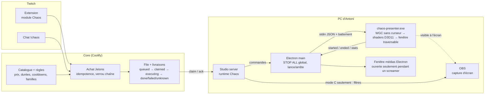

# Architecture Chaos V2

10/11/2026. Proposition argumentée, rien n'est construit. Preuves : [RECHERCHE](RECHERCHE_CHAOS_V2.md).

## 0. Verdict (les 10 questions du mandat)

1. **Retournement local propre, sans double curseur ni carré, sans toucher aux entrées ?**
   **Oui pour le curseur de Windows, non démontré de bout en bout.**
   - La partie décisive est **prouvée** sur ce PC : une capture WGC native sans curseur livre l'image sans aucun curseur
     ni retouche (PROTO).
   - Le vrai curseur, dessiné par Windows au-dessus de toute fenêtre, reste seul et cliquable (DOC + comportement V1).
   - Reste à prouver l'affichage par le lecteur natif : lot 1, R1.
2. **Conditions** :
   - jeu en fenêtré ou sans bordure ;
   - curseur du jeu = curseur Windows (vrai pour les FPS en « raw input », où le curseur est caché ; à vérifier pour
     Dofus) ;
   - un lecteur natif, pas Chromium.
3. **Limites** :
   - plein écran exclusif : rien ne passe au-dessus ;
   - curseur ou viseur **dessiné par le jeu** : il est retourné avec l'image (impossible à éviter sans injection) ;
   - 1 à 2 images de latence ;
   - perte probable de l'independent flip et de VRR pendant l'effet.
4. **Meilleure architecture** : D, un lecteur natif vu par OBS (§ 2-3), avec C en secours et A en repli.
5. **Causes probables des chutes** :
   - la copie V1 limitée par la lecture GPU → CPU de Chromium (C1, la plus probable) ;
   - OBS en priorité GPU temps réel, avec un gros flou 1440p (C2, priorité **prouvée**) ;
   - les fenêtres permanentes qui font composer le jeu par DWM (C3) ;
   - les effets dessinés coûteux (C4) ;
   - l'écran à 59 Hz (C5).
6. **Tests qui les confirment** : protocole E0 → E7 avec PresentMon (RECHERCHE § 6), lot 0.
7. **Effets qui valent la peine** :
   - flip / miroir ;
   - flou Kawase ;
   - Brouillard V2 ;
   - Signal corrompu V2 ;
   - tunnel ;
   - puzzle ;
   - les screamers existants.

   Voir CATALOGUE § 2.

8. **À abandonner** :
   - faux curseur, masquage du curseur ;
   - toute manipulation de la souris ;
   - rotation continue et secousses sur l'écran du joueur ;
   - stroboscope ;
   - glitch et brouillard V1 ;
   - rendu par `getDisplayMedia`.
9. **Arrêt fiable** : le lecteur est la seule chose qui modifie l'écran, ne vit que pendant l'effet et meurt avec
   Studio. Rien à restaurer (§ 6).
10. **Premier lot intelligent** :
    - **lot 0**, mesurer et couper les fenêtres permanentes, sans code ;
    - puis **lot 1**, le lecteur natif flip seul, testable sans Core ni Jetons. C'est le seul vrai risque technique,
      on le lève avant de construire la boutique.

## 1. Contraintes qui décident

1. **Visuel seulement** : aucune entrée touchée, aucune injection, aucun état Windows modifié (pas de loupe, pas de
   curseurs système remplacés, pas de rotation d'écran).
2. **Un seul curseur**, le vrai, à ses coordonnées réelles : il faut une capture **sans curseur en amont** — Chromium ne
   sait pas le faire (RECHERCHE § 2), WGC natif oui (**PROTO**).
3. **Aucun aller-retour GPU → CPU par image** pour l'écran du joueur (cause n°1 des chutes, RECHERCHE § 3).
4. **Restauration par construction** : si quelque chose plante, l'écran redevient normal **sans qu'aucune action de
   nettoyage soit nécessaire**.
5. **Zéro coût au repos** : aucune fenêtre au-dessus du jeu quand rien ne joue (corrige AUDIT D1).
6. Le moins de plugins OBS tiers possible.

## 2. Quatre architectures comparées

|                             | **A. OBS seulement**                                                                         | **B. Electron amélioré**                                                                       | **C. Lecteur natif + filtres OBS**                                                                                                                                                                         | **D. Lecteur natif vu par OBS**                                                                                                                                            |
| --------------------------- | -------------------------------------------------------------------------------------------- | ---------------------------------------------------------------------------------------------- | ---------------------------------------------------------------------------------------------------------------------------------------------------------------------------------------------------------- | -------------------------------------------------------------------------------------------------------------------------------------------------------------------------- |
| Principe                    | effets appliqués par des filtres OBS ; l'écran du joueur ne change pas (ou un simple repère) | les fenêtres V1, ouvertes seulement pendant un effet, sans capture (effets dessinés seulement) | un exécutable natif capture **l'écran** (WGC sans curseur), applique le shader et l'affiche dans une fenêtre traversable **exclue des captures** ; OBS reçoit le même effet par ses filtres (topologie V1) | le même exécutable capture **la fenêtre du jeu** et affiche le résultat par-dessus, **sans exclusion** : la capture d'écran d'OBS montre directement ce que voit le joueur |
| Écran du joueur retourné    | ❌                                                                                           | ❌                                                                                             | ✅                                                                                                                                                                                                         | ✅                                                                                                                                                                         |
| Un seul curseur, sans carré | —                                                                                            | —                                                                                              | ✅                                                                                                                                                                                                         | ✅                                                                                                                                                                         |
| Coût local                  | nul, mais OBS prioritaire sur le GPU (C2)                                                    | faible, uniquement pendant l'effet                                                             | GPU seulement, 1 passe + composition                                                                                                                                                                       | GPU seulement, 1 passe + composition                                                                                                                                       |
| Coût OBS                    | filtres lourds (flou 1440p)                                                                  | —                                                                                              | **double** : filtres OBS en plus                                                                                                                                                                           | **aucun filtre** : OBS capture déjà l'écran                                                                                                                                |
| Stream = écran du joueur    | —                                                                                            | ✅                                                                                             | ⚠️ deux rendus à garder identiques                                                                                                                                                                         | ✅ **par construction**                                                                                                                                                    |
| Plugins tiers               | shaderfilter, Composite Blur                                                                 | —                                                                                              | shaderfilter, Composite Blur                                                                                                                                                                               | aucun pour Chaos                                                                                                                                                           |
| Couvre                      | tout                                                                                         | tout                                                                                           | tout l'écran, quelle que soit l'appli                                                                                                                                                                      | la fenêtre du jeu (choisie au lancement de l'effet)                                                                                                                        |
| Prérequis OBS               | —                                                                                            | —                                                                                              | —                                                                                                                                                                                                          | les scènes doivent capturer **l'écran** (c'est le cas : `monitor_capture` « Écran ») ; une « capture de jeu » ne verrait pas l'effet                                       |
| Risques                     | aucun local ; le cœur de l'effet (le joueur gêné) disparaît                                  | aucun progrès sur le flip                                                                      | synchronisation de deux rendus, dépendance aux plugins après chaque mise à jour d'OBS                                                                                                                      | choix de la fenêtre (jeu, lanceur, bureau) ; si le joueur change de fenêtre pendant l'effet, la copie reste au-dessus jusqu'à la fin (≤ 60 s)                              |
| Effort                      | faible                                                                                       | faible                                                                                         | élevé                                                                                                                                                                                                      | élevé (même binaire que C)                                                                                                                                                 |

**Pourquoi pas seulement A ?** C'est le plus léger, mais il supprime ce que la communauté achète : voir Antoni gêné.
A reste le **mode dégradé** automatique (plein écran exclusif, lecteur absent).

## 3. Recommandation

**D comme cible, C comme mode de secours du même binaire, A comme repli automatique, B pour les médias (screamers).**

- Un seul exécutable natif, le **lecteur Chaos** (`chaos-presenter.exe`), sait capturer soit une fenêtre (D), soit un
  écran avec exclusion de capture (C). Le choix se fait à l'exécution.
- D est préféré parce qu'il supprime la moitié OBS de Chaos : plus de filtres à préparer, plus de deuxième rendu à
  synchroniser, **plus de flou Gaussien dans OBS** (un des suspects des chutes) et plus de dépendance aux plugins pour
  Chaos.
- Le choix définitif D / C se fait sur le test **E8** (capture WGC de la fenêtre d'Overwatch, de Dofus et d'un jeu
  d'horreur) : si une capture de fenêtre échoue sur un jeu (noir, refus), ce jeu passe en C.
- Les screamers et apparitions (vidéos alpha avec son) restent dans une fenêtre Electron, **ouverte seulement pendant
  la lecture**. Leur lecture vidéo et leur son sont validés depuis le 28/10 ; les réécrire en natif n'apporte rien.

### Langage du lecteur natif

Rust avec `windows-rs` (bindings officiels Microsoft) ou C++/WinRT. Je recommande **Rust** : un exécutable unique sans
runtime, et la sûreté mémoire dans un processus qui manipule des textures. **Coût réel** : aucun compilateur n'est
installé sur le PC aujourd'hui. Il faut ajouter Rust à la CI (GitHub Actions Windows) et l'intégrer à
`npm run studio:release` (ressource embarquée par electron-builder). Un addon Node natif est **écarté** : s'il plantait,
il ferait tomber Studio.

## 4. Composants et responsabilités

| Composant                         | Fait                                                                                                                                 | Ne fait jamais                                                     |
| --------------------------------- | ------------------------------------------------------------------------------------------------------------------------------------ | ------------------------------------------------------------------ |
| **Core**                          | catalogue, prix en Jetons, familles autorisées, file, débit, remboursement, journal ; **seule source de vérité** des réglages vendus | dessiner, connaître OBS                                            |
| **Studio server** (runtime Chaos) | réclame les livraisons, applique les règles locales (écran, sécurité, mode sûr), choisit le mode D / C / A, rapporte au Core         | décider d'un prix                                                  |
| **Electron main**                 | lance le lecteur à la demande, lui envoie un battement, porte le STOP ALL global (`Ctrl+Maj+F12`), ouvre la fenêtre médias           | rendre un effet de capture                                         |
| **chaos-presenter.exe**           | une capture WGC (fenêtre ou écran, curseur exclu, sans bordure), les shaders, une fenêtre traversable ; s'arrête seul                | toucher une entrée, modifier un réglage Windows, survivre à Studio |
| **OBS**                           | capture l'écran comme aujourd'hui ; en mode C seulement, filtres « Raptoru Chaos · … »                                               | —                                                                  |

## 5. Le lecteur natif en détail

**Fenêtre** :

- styles `WS_EX_TOPMOST`, `TRANSPARENT`, `LAYERED`, `NOACTIVATE`, `TOOLWINDOW`, `NOREDIRECTIONBITMAP` : jamais de focus,
  jamais de clic, absente de la barre des tâches ;
- swapchain DirectComposition en modèle flip, alpha prémultiplié, pour les effets transparents ;
- mode C seulement : `WDA_EXCLUDEFROMCAPTURE` ([S32] dans RECHERCHE), avec une image d'attente avant de démarrer la
  capture.

**Pipeline GPU** :

1. `Direct3D11CaptureFramePool.CreateFreeThreaded`, `IsCursorCaptureEnabled(false)`, `IsBorderRequired(false)` ;
2. `CopyResource` dans une texture du lecteur, **jamais de `Map`** ;
3. un shader par effet (HLSL), deux pour un flou Dual Kawase à résolution réduite ;
4. `Present` à la fréquence de l'écran, sans attendre au-delà d'une image.

**Démarrage sans flash** : la fenêtre n'est montrée qu'avec la première image transformée, comme V1 (aucune image
noire). Pour une rotation animée, les coins découverts sont remplis par une copie floutée et assombrie de l'image :
jamais le vrai bureau.

**Contrôle** : JSON ligne par ligne sur stdin/stdout.

- Commandes : `play {id, effect, variant, params, max_ms}`, `stop {id}`, `stop_all`, `ping`.
- Événements :
  - `started {id}` : première image réellement présentée ;
  - `ended {id}` ;
  - `failed {id, reason}`, raisons possibles `exclusive_fullscreen`, `capture_denied`, `no_window`… ;
  - `stats {present_fps, capture_fps, gpu_ms}`.

## 6. Garanties d'arrêt (restauration par construction)

| Situation                                       | Ce qui arrête l'effet                                                                                 | Délai            |
| ----------------------------------------------- | ----------------------------------------------------------------------------------------------------- | ---------------- |
| Fin normale                                     | `max_ms` interne au lecteur (en plus de la durée Studio)                                              | à l'image près   |
| STOP ALL (bouton, `Ctrl+Maj+F12`, Studio, Core) | `stop_all` → fenêtre détruite                                                                         | < 100 ms visé    |
| Studio gelé                                     | plus de battement depuis 2 s → le lecteur s'arrête et quitte                                          | ≤ 2 s            |
| Studio fermé ou planté                          | stdin fermé / le lecteur surveille le processus parent → quitte                                       | immédiat         |
| Lecteur planté                                  | Windows détruit ses fenêtres avec le processus : **rien à restaurer**                                 | immédiat         |
| Effet orphelin au redémarrage                   | le lecteur n'existe que pendant un effet ; rien n'est rejoué (règle V1 gardée)                        | —                |
| OBS déconnecté                                  | mode D : rien à faire ; mode C : ObsActions coupe le filtre à la reconnexion (retour conditionnel V1) | à la reconnexion |
| Core injoignable                                | l'effet en cours finit seul ; aucun nouvel effet ; le rapport est renvoyé plus tard                   | —                |
| Fenêtre bloquante                               | impossible : la fenêtre ne prend ni clic ni clavier ; durée max absolue 60 s                          | —                |

Aucun watchdog séparé n'est nécessaire : le lecteur **est** la seule chose qui modifie l'affichage et il ne vit que
pendant l'effet. Un watchdog dans un troisième processus ajouterait une pièce sans réduire le risque.

## 7. Où vivent les réglages

| Réglage                                                                                                    | Où                                                                | Pourquoi                                                    |
| ---------------------------------------------------------------------------------------------------------- | ----------------------------------------------------------------- | ----------------------------------------------------------- |
| Catalogue, prix, durées vendues, cooldowns, variantes autorisées, familles actives, Chaos actif            | **Core**                                                          | ce qui est vendu doit être décidé là où l'achat est accepté |
| Écran / fenêtre visée, mode sûr, plafonds de sécurité (§ ACCESSIBILITÉ du catalogue), mode D / C / A forcé | **Studio** (réglages locaux)                                      | propre au PC                                                |
| Paramètres techniques d'un effet (shader, intensité exacte d'une variante)                                 | **lecteur** (table compilée), sélectionnés par un nom de variante | le Core vend « Brouillard dense », jamais un nombre libre   |

## 8. Ce qu'on garde, remplace, supprime

| Garder                                                                                                                                                                                       | Remplacer                                                                                                                     | Supprimer                                                                            |
| -------------------------------------------------------------------------------------------------------------------------------------------------------------------------------------------- | ----------------------------------------------------------------------------------------------------------------------------- | ------------------------------------------------------------------------------------ |
| La machine à états des livraisons (event-shop : idempotence, remboursement si jamais démarré, `unknown`, STOP ALL) ; ObsActions ; le raccourci global ; la fenêtre médias pour les screamers | rendu flip/blur V1 → lecteur natif ; Bonbons → Jetons (Wallet existant) ; brouillard et glitch dessinés → shaders sur capture | `hideCursor` ; fenêtres permanentes ; en mode D, les 6 filtres « Raptoru Chaos · … » |

## 9. Diagnostic

- Studio affiche, pendant un effet, ce que le lecteur rapporte : images présentées par seconde, images capturées par
  seconde, temps GPU, mode (D / C / A), raison d'un échec.
- Chaque livraison garde son parcours (réclamée, démarrée, terminée, temps de première image) dans le journal Studio et
  le statut Core.
- Un bouton « Tester » rejoue un effet localement sans Core ni Jeton (règle V1 gardée).

## 10. Produit : économie, file, extension, Studio

### 10.1 Core : un module du socle, pas une seconde boutique

Le Core a déjà le bon moteur : le **socle de modules** (`apps/core-api/src/modules/host.ts`, contrats dans
`docs/studio-refonte/architecture/CONTRATS.md`). Il fournit :

- l'intention idempotente, la pause globale, le blocage d'un viewer, l'interrupteur du module et le live (H1) ;
- le journal `module_activity` et le **débit Jetons** sur le Wallet, en une seule transaction ;
- la protection `price_changed` ;
- les actions en file **réclamées par un lecteur** avec un bail (`PLAYER_LEASE_MS` = 30 s), l'expiration remboursée
  une fois et le remboursement par modération ;
- les réglages dans Studio et l'affichage dans l'extension.

Le « Coffre mystère » (`modules/coffre-mystere.ts`, Lab) en est la démonstration : un paiement en Jetons, un lecteur OBS
qui réclame, une expiration remboursée.

**Chaos V2 = un module `chaos` de ce socle**, payé en **Jetons** (les Bonbons d'Halloween ne sont pas repris). Il ne
crée ni table de monnaie ni seconde économie. L'event-shop d'Halloween reste fermé, tel quel.

**Écart à combler** dans le socle, à faire dans le lot 2 par une évolution contrôlée du contrat :

- aujourd'hui une action est `queued`, puis `done`, `failed`, `refunded` ou `canceled` ;
- Chaos a besoin d'un **« démarré »** (première image réellement affichée) pour appliquer la règle éprouvée d'Halloween :
  remboursé si jamais démarré, non remboursé si démarré.
- Proposition : `report(started)` horodate `started_at` sous verrou et prolonge le bail jusqu'à la durée maximale. Un
  `failed` après `started_at` suit la règle de remboursement ci-dessous.

### 10.2 Remboursements (règle proposée, à valider par Antoni)

| Situation                    | Exemple                                                                                                 | Remboursement                                                           |
| ---------------------------- | ------------------------------------------------------------------------------------------------------- | ----------------------------------------------------------------------- |
| Jamais démarré               | lecteur absent, plein écran exclusif sans repli possible, file expirée, Studio fermé, refus du mode sûr | **automatique, intégral, une fois**                                     |
| Démarré puis panne **tôt**   | le lecteur plante avant 25 % de la durée                                                                | **automatique** (proposition)                                           |
| Démarré puis panne tardive   | après 25 %                                                                                              | aucun ; remboursement manuel possible par un modérateur                 |
| Arrêt volontaire (STOP ALL)  | Antoni coupe l'effet                                                                                    | **question ouverte** ; V1 : aucun remboursement                         |
| Fin inconnue (aucun rapport) | Studio tué pendant l'effet                                                                              | aucun automatique (il a pu être vu) ; signalé dans Studio pour décision |

Le Core ne sait **jamais** si un effet a été vu : il ne fait confiance qu'aux rapports `started` / `ended` du lecteur.

### 10.3 File et familles

- **Une file par chaîne, FIFO, courte** :
  - 3 achats en attente au plus, 1 par viewer ;
  - expiration au bout de 3 min, remboursée ;
  - au-delà, refus `queue_full`, sans débit.
  - V1 n'avait pas de file et refusait `busy` : le viewer devait réessayer.
- **Familles** : Orientation, Perception, Lisibilité, Calque, Média.
  - Il ne joue **qu'un seul effet de capture à la fois** (Orientation, Perception, Lisibilité partagent la capture).
  - Un Calque peut s'ajouter pendant une capture, dans la limite du catalogue § 4.
  - Les Médias ont leur propre fenêtre et passent l'un après l'autre.
- Studio réclame l'action suivante **seulement quand elle peut jouer**. Une action incompatible reste en file ; le Core
  n'a pas à connaître la compatibilité.
- **Cooldown** par effet et par famille, réglable dans Studio. Il compte les achats **démarrés**, pas les remboursés
  (règle V1).

### 10.4 Disponibilité affichée (vérité unique : le Core)

Pour chaque effet, le Core calcule un état, et l'extension ne fait que l'afficher :

| État              | Signification                                                                                                                       |
| ----------------- | ----------------------------------------------------------------------------------------------------------------------------------- |
| `disponible`      | —                                                                                                                                   |
| `en_file`         | position n                                                                                                                          |
| `cooldown`        | jusqu'à `t`                                                                                                                         |
| `famille_occupée` | un effet de la même famille joue ; il peut être acheté et attendra son tour                                                         |
| `hors_live`       | **libellé à ajouter**, voir AUDIT D5                                                                                                |
| `lecteur_absent`  | Studio a annoncé que le lecteur Chaos est indisponible : plein écran exclusif, OBS sans capture d'écran en mode D… Corrige AUDIT D2 |
| `refusé_mode_sûr` | la variante est interdite en mode sûr                                                                                               |
| `désactivé`       | —                                                                                                                                   |

Le battement de Studio annonce au Core : lecteur prêt, mode (D / C / A), mode sûr, variantes interdites.

### 10.5 Extension

- **Intégration** :
  - un module « Chaos » dans l'extension existante ;
  - mêmes composants que les autres modules du socle (`GUIDE_EXTENSION.md`) ;
  - achat en deux temps, déjà éprouvé : « ◆ prix », puis « Confirmer ? » pendant 3,5 s, avec une clé d'idempotence
    stable.
- **Structure** :
  - onglets courts par famille (Orientation · Perception · Lisibilité · Fun) ;
  - une carte par effet : vignette, nom, durée, prix, état ;
  - **2 ou 3 variantes au plus**, en boutons segmentés (« Léger / Dense », « 15 s / 30 s ») ; chaque variante a son
    propre prix, jamais de curseur libre.
- **Toujours visible en haut** : l'effet en cours (avec le temps restant) et la file (« Vous êtes 2ᵉ »). Mes achats
  récents avec leur statut et « remboursé ».
- **Messages** : courts, une ligne. Les raisons de refus viennent du Core, avec les libellés existants plus
  `queue_full`, `hors_live` et `lecteur_absent`.
- **Prévisualisation** : la vignette animée existante (SVG), pas de vidéo, pour garder le module léger.
- **Responsive** :
  - cartes en grille fluide, 1 colonne sous 360 px ;
  - aucun texte superposé, libellés tronqués avec la description dans une ligne repliable ;
  - mêmes largeurs de test que la recette de l'extension (318 / 400 / 565 px).

### 10.6 Studio Coulisses

Une page « Chaos » du socle : réglages générés depuis le module, plus un panneau propre. **Progressive** : l'essentiel
est en haut, les détails sont repliés.

1. **Bandeau** :
   - Chaos activé ;
   - état du lecteur : prêt / absent / mode A, avec la raison en une ligne ;
   - **STOP ALL** ;
   - « Vider la file ».
2. **En cours et file** : effet, viewer, temps restant ; « Arrêter » par ligne.
3. **Tester** : un bouton par effet et par variante, gratuit, local.
4. **Catalogue** : un tableau compact (effet, actif, prix, durée, cooldown, variantes autorisées) dans la grille du
   design system, plus les familles autorisées.
5. **Sécurité** : mode sûr et plafonds (CATALOGUE § 4).
6. **Diagnostic** (replié) :
   - images affichées et capturées par seconde, temps GPU du dernier effet ;
   - OBS relié, scène qui capture l'écran ;
   - les 20 dernières livraisons avec leur parcours.
7. **Historique** : vue du journal du socle.

## 11. Risques liés aux mises à jour

| Mise à jour   | Risque                                       | Parade                                                                                                       |
| ------------- | -------------------------------------------- | ------------------------------------------------------------------------------------------------------------ |
| OBS           | plugins cassés (vu le 10/11 avec OBS 33)     | mode D : Chaos n'en dépend plus ; FX Cam (shaderfilter) reste exposé                                         |
| Windows       | changements de WGC / DWM                     | API publiques et documentées ; tests E2, E5 et E8 à refaire après une grosse mise à jour                     |
| Pilote NVIDIA | VRR / MPO                                    | protocole de mesure comme garde-fou de livraison                                                             |
| Jeux          | passage en plein écran exclusif, anti-triche | aucune injection = aucun risque anti-triche ; plein écran exclusif → mode A automatique, annoncé dans Studio |
