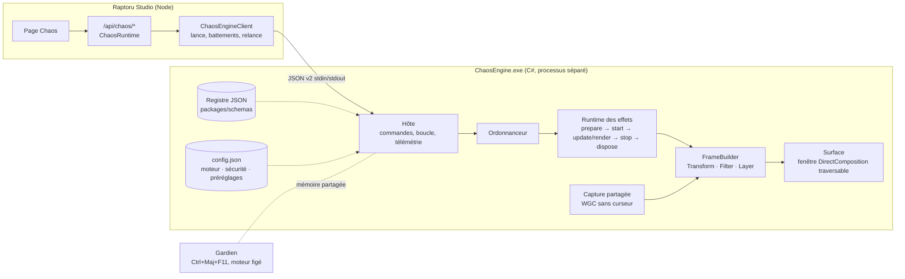

# Moteur Chaos V2 : architecture

22/11/2026. Le moteur d'effets d'écran de Raptoru (« Chaos Overlay », que tu appelles aussi « KO Overlay »). Il
remplace le prototype du lot 1.

- Code : [`apps/chaos-engine`](../../apps/chaos-engine/README.md).
- Interface : Studio › Chaos, et le banc Chaos Lab.
- Contrats : [CONTRATS_MOTEUR.md](CONTRATS_MOTEUR.md).
- Un seul effet réel : **le retournement à 180°**. Il traverse tous les composants.

## 1. Vue d'ensemble

- **Processus séparé** : une panne du moteur ne touche pas Studio. La fenêtre d'un effet appartient au moteur, donc
  elle disparaît avec lui.
- **Une seule source de vérité des effets** : `packages/schemas/src/chaos-registry.json`.
  - Le moteur l'embarque à la compilation.
  - Studio la lit par `describe`.
  - Le Core et l'extension la liront via `@raptoru/schemas`.
- **C#** (.NET Framework 4.8, compilé par le `csc.exe` de Windows, rien à installer).
  - Le prototype l'avait choisi par nécessité, faute de pouvoir installer Rust.
  - Les mesures montrent qu'il ne coûte rien de visible : 0,03 à 0,08 ms de GPU par passe en 1440p.
  - Rust n'apporterait rien de mesurable ici.

## 2. Sous-systèmes : ce qui est implémenté, ce qui est seulement prévu

| Sous-système (fichiers)                                                 | Implémenté et testé                                                                                                                                                                                                                                                                              | Interface prévue, non utilisée                                                                                       |
| ----------------------------------------------------------------------- | ------------------------------------------------------------------------------------------------------------------------------------------------------------------------------------------------------------------------------------------------------------------------------------------------ | -------------------------------------------------------------------------------------------------------------------- |
| **Registre** (`Model/Registry.cs`, `chaos-registry.json`, `chaos.ts`)   | Identité, famille, emplacement, paramètres typés (bornes, défauts, animable/neutre, exposé), variantes, transitions permises, conditions d'arrêt. Validation stricte et versionnée. Cohérence registre ↔ implémentations vérifiée au démarrage. Schéma zod côté TypeScript                       | « exigences GPU » : seulement descriptives (`gpu.primitive`, `cost`)                                                 |
| **Configuration** (`Model/Config.cs`)                                   | Sections moteur, sécurité et préréglages ; validation ; écriture atomique ; migration v1 → v2 avec sauvegarde ; valeurs invalides ignorées une à une ; réinitialisation par section                                                                                                              | Réglages commerciaux : **volontairement absents**, ils appartiendront au Core                                        |
| **Paramètres** (`Model/Params.cs`)                                      | Défauts → variante → préréglage → demande, sans correction silencieuse. Seule exception : une transition trop rapide est rallongée, et cet ajustement est signalé. Plafond de vitesse angulaire, mode sûr                                                                                        | —                                                                                                                    |
| **Transitions** (`Model/Transitions.cs`)                                | Courbes. Animateur de « présence » commun à tous les effets : un paramètre animable passe de sa valeur neutre à sa cible. Une interruption repart de la valeur courante, sans saut. Coupure franche ou rampe                                                                                     | Fondu d'opacité générique d'un effet : non nécessaire au retournement                                                |
| **Ordonnanceur** (`Model/Scheduler.cs`)                                 | Logique pure et déterministe : file d'attente, priorités, exclusivité et nombre maximal par emplacement, plafond global, politiques file / remplacement / rejet / prolongation, annulation douce ou immédiate, expiration de la file, délai de démarrage, STOP ALL, idempotence par `request_id` | —                                                                                                                    |
| **Capture** (`Capture/Capture.cs`)                                      | `ICaptureSource` et sa mise en œuvre WGC (fenêtre ou écran, curseur exclu, sans bordure). Une capture partagée par cible et comptée par utilisateurs, gardée 2 s puis arrêtée. Redimensionnement, cible perdue, image noire, images perdues comptées. Copie GPU de la dernière image             | D'autres techniques de capture (DXGI, etc.) : il suffira d'implémenter l'interface                                   |
| **Rendu** (`Render/*`)                                                  | `FrameBuilder` : chaîne de passes sur une seule capture, la dernière passe écrivant directement dans l'image affichée. Pool de cibles libéré au repos, bibliothèque de shaders (en-tête commun, cache mémoire et disque), mesure GPU par passe, repli de qualité                                 | Graphe à branches (passes parallèles) : une chaîne suffit aux familles prévues                                       |
| **Calques** (`Render/Frame.cs`, `TextRaster.cs`)                        | Formes (rectangle arrondi, ellipse, anneau), texte et image (mis en cache), position, taille, rotation, opacité, mélange alpha. Sans capture, ou par-dessus une chaîne                                                                                                                           | Masques de calque : à ajouter quand un effet en aura besoin                                                          |
| **Runtime des effets** (`Effects/Effect.cs`)                            | Cycle de vie standard, chaque étape isolée : un effet en panne s'arrête seul. Catalogue des implémentations                                                                                                                                                                                      | —                                                                                                                    |
| **Surfaces** (`Present/Surface.cs`)                                     | Fenêtre traversable, jamais activée, présente seulement pendant un effet. Suit la fenêtre visée, se masque hors premier plan. Mode C (écran entier, exclu des captures)                                                                                                                          | —                                                                                                                    |
| **Hôte** (`Host/*`)                                                     | Protocole v2, télémétrie, repli de qualité, chiens de garde, gardien, liste des fenêtres                                                                                                                                                                                                         | —                                                                                                                    |
| **Studio** (`apps/studio/server/src/chaos/*`, `web/src/pages/chaos.ts`) | Pilote du moteur (lancement à la demande, battements, relance avec délais croissants), API `/api/chaos/*`, page Chaos, banc Chaos Lab                                                                                                                                                            | Commandes du Core, de l'extension et des points de chaîne : prévues dans le contrat (`source`), pas encore branchées |

## 3. Le retournement, de bout en bout

1. **Registre** : `flip` = emplacement `transform` (capture requise), paramètre `angle` (animable, neutre 0, cible 180,
   non exposé) et paramètre `fill` (`mirror`, `black`, `cover`).
2. **Configuration** : le préréglage `default` (coins, durée, transitions) est réglé dans Studio.
3. **Validation** : `Params.Resolve` et le plafond de 520°/s (entrée en rotation d'au moins 545 ms).
4. **Ordonnancement** : `Scheduler.Submit` accepte la demande, la met en file ou la refuse.
5. **Capture** : `CaptureManager.Acquire(window:<hwnd>)`, partagée.
6. **Rendu GPU** : `FlipEffect.Render` consiste en un seul appel : `fb.Transform(angle animé, fill)`.
7. **Transition** : l'animateur donne la présence, et `EffectFrame.Animated("angle")` passe de 0 à 180°.
8. **Présentation** : `Surface.Present`. La fenêtre n'apparaît qu'avec une image prête.
9. **Télémétrie** : capture et présentation par seconde, traitement, GPU par passe, CPU, mémoire.
10. **Arrêt** : durée, annulation, STOP ALL, cible perdue, panne, gardien.
11. **Libération** : effet détruit, surface détruite, capture gardée 2 s puis fermée, pool vidé après 3 s.
12. **Retour vers Studio** : événements `effect.*`, `status`, `engine.telemetry`.

**Correctif du lot 1 (l'ancien écran visible pendant la rotation).** Les coins découverts ne montrent plus jamais
l'image d'origine. Le mode `mirror` (défaut) prolonge en miroir, flou et assombri, **l'image déjà tournée**. Les modes
`black` et `cover` (agrandissement juste suffisant) sont proposés dans Studio. Pour comparer : `ChaosEngine.exe
--render-preview <dossier>`.

## 4. Performances (mesurées le 22/11, RTX 3070, sans jeu)

| Mesure                     | Résultat                                                                                                                 | Comment                               |
| -------------------------- | ------------------------------------------------------------------------------------------------------------------------ | ------------------------------------- |
| GPU par passe en 2560×1440 | 0,036 ms (180° exact), 0,038 ms (rotation, coins flous), 0,024 ms (coins noirs) ; mipmaps environ 0,04 ms                | `--bench-gpu`, 300 images, hors écran |
| Retournement sur la mire   | capture environ 58 i/s, présentation environ 58 i/s, traitement médian 0,7 ms (p95 environ 4 ms), GPU 0,08 ms, CPU 0,3 % | `chaos-checks`                        |
| Moteur au repos            | aucune fenêtre, aucune capture, aucune cible GPU ; environ 9 Mo de mémoire vidéo                                         | `chaos-checks` (§ 12)                 |
| Démarrage du moteur        | prêt en 250 à 310 ms (GPU environ 180 ms, shaders 23 à 34 ms ; plus rapide avec le cache disque)                         | `engine.ready`                        |

Ce sont des mesures **internes**. Ni la latence ressentie en jeu ni l'effet sur les FPS d'un jeu n'ont été mesurés :
voir [PROCEDURE_TESTS.md](PROCEDURE_TESTS.md) § 3.

## 5. Ajouter un effet

Voir [GUIDE_EFFETS.md](GUIDE_EFFETS.md) : une entrée dans le registre, une classe de quelques lignes, une ligne dans le
catalogue. Rien d'autre ne change : capture, ordonnanceur, transitions, Studio, protocole.
